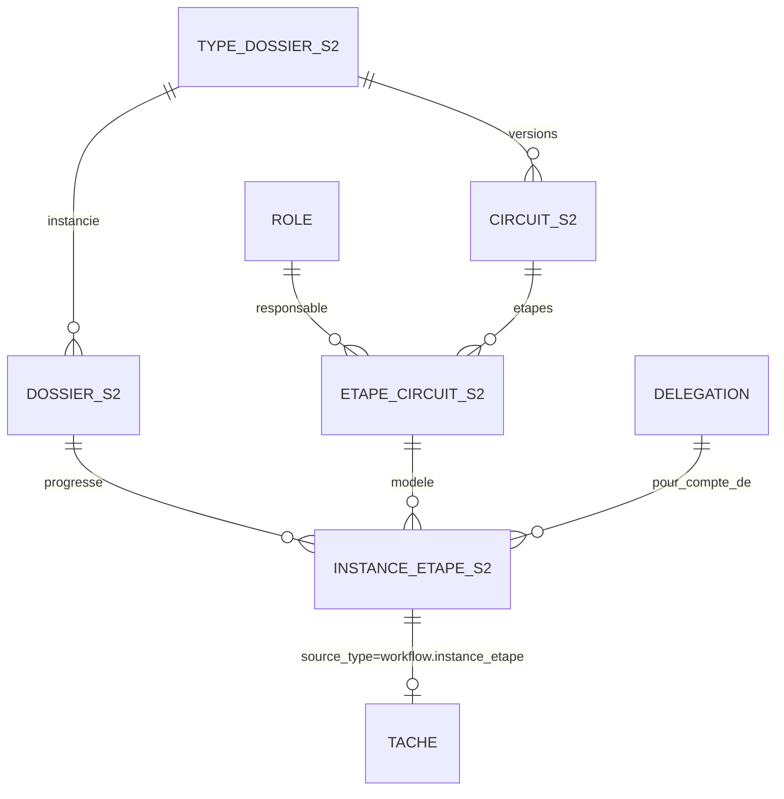

<!-- Généré depuis docs/architecture-sprint1.md -->
## 2. Modèle de données

### 2.1 Conventions communes

- Clé primaire `id uuid` (générée par Django, `uuid4`), sauf `evenement_audit` (`bigint` identité).
- Horodatages `timestamptz` ; `USE_TZ=True`, `TIME_ZONE="Africa/Dakar"`.
- Énumérations : `varchar` + contrainte `CHECK` (générée par `models.TextChoices` + `CheckConstraint`).
- Montants : `numeric(18,2)` ; devise `char(3)`, `XOF` par défaut.
- Toute table tenant : `etablissement_id uuid NOT NULL REFERENCES etablissement(id) ON DELETE RESTRICT`, index en tête de chaque index composite, RLS activée et forcée (section 3).
- Extensions : `citext`, `btree_gist` (toutes deux « trusted », créées par `alpha_owner` dans la migration `tenancy.0001`).

### 2.2 Tables

#### `etablissement` (app tenancy)

| Champ | Type | Contraintes |
|---|---|---|
| id | uuid | PK |
| code | varchar(40) | UNIQUE, `^[a-z0-9-]+$` (ex. `banque-demo`) |
| raison_sociale | varchar(200) | NOT NULL |
| type | varchar(10) | CHECK IN (`BANQUE`,`SFD`,`PME`) |
| pays | char(2) | défaut `SN` |
| statut | varchar(15) | CHECK IN (`ACTIF`,`LECTURE_SEULE`,`SUSPENDU`,`ARCHIVE`) ; défaut `ACTIF` (anticipe la facturation, CDC §7) |
| fuseau_horaire | varchar(40) | défaut `Africa/Dakar` |
| cree_le, modifie_le | timestamptz | NOT NULL |
| cree_par_id | uuid | FK `utilisateur` (super-admin), NULL |

Index : `UNIQUE(code)`. RLS : politique spécifique (3.4).

#### `parametres_etablissement` (tenancy, 1–1)

| Champ | Type | Contraintes / défaut |
|---|---|---|
| etablissement_id | uuid | PK et FK `etablissement` |
| inactivite_session_min | smallint | 15, CHECK 5–60 |
| duree_max_session_h | smallint | 12, CHECK 1–24 |
| mdp_longueur_min | smallint | 12, CHECK ≥ 12 |
| mdp_historique | smallint | 5 |
| tentatives_max | smallint | 5 |
| verrouillage_min | smallint | 15 |
| validite_invitation_h | smallint | 72 |
| retention_audit_annees | smallint | 10 |
| modules_actifs | text[] | dérivé du type (S2/S3 : menu par module) |
| modifie_le | timestamptz | |

#### `utilisateur` (comptes, `AUTH_USER_MODEL`)

| Champ | Type | Contraintes |
|---|---|---|
| id | uuid | PK |
| etablissement_id | uuid | FK, **NULL uniquement pour un super-admin** |
| est_super_admin | boolean | défaut false ; CHECK `(etablissement_id IS NULL) = est_super_admin` |
| email | citext | **UNIQUE global** (hypothèse H1 : pas de sélection d'établissement à la connexion) |
| prenom, nom | varchar(80) | NOT NULL |
| telephone_mobile | varchar(20) | format E.164, NULL |
| langue | varchar(2) | `fr`/`en`, défaut `fr` |
| password | varchar(128) | Argon2id (format Django) ; vide tant que statut `INVITE` |
| statut | varchar(12) | CHECK IN (`INVITE`,`ACTIF`,`SUSPENDU`,`DESACTIVE`) |
| responsable_id | uuid | FK `utilisateur` même établissement, NULL (valide les absences) |
| mfa_a_reconfigurer | boolean | défaut false (après téléphone perdu) |
| signature_bloquee | boolean | défaut false (téléphone perdu ; lu par la signature S2) |
| echecs_connexion | smallint | défaut 0 |
| verrouille_jusqua | timestamptz | NULL |
| verrouillages_24h | smallint | défaut 0 ; à 3 → verrouillage jusqu'à déblocage administrateur |
| bloque_par_admin | boolean | défaut false |
| derniere_connexion | timestamptz | NULL |
| mdp_modifie_le | timestamptz | NULL |
| active_le | timestamptz | NULL |
| cree_le, modifie_le | timestamptz | |
| cree_par_id | uuid | FK `utilisateur`, NULL |

Index : `UNIQUE(email)`, `(etablissement_id, statut)`, `(etablissement_id, nom, prenom)`, `(responsable_id)`.

#### `authenticator_totp` (comptes)

| Champ | Type | Contraintes |
|---|---|---|
| id | uuid | PK |
| etablissement_id | uuid | FK, NULL pour super-admin |
| utilisateur_id | uuid | FK `utilisateur` ON DELETE CASCADE |
| secret_chiffre | bytea | jeton MultiFernet du secret base32 (160 bits) |
| cle_version | smallint | version de clé (rotation) |
| libelle | varchar(80) | ex. « iPhone de Cheikh », facultatif |
| statut | varchar(10) | CHECK IN (`EN_ATTENTE`,`ACTIF`,`SUSPENDU`,`REVOQUE`) |
| dernier_pas | bigint | dernier compteur TOTP accepté (anti-rejeu), NULL |
| cree_le, confirme_le, revoque_le | timestamptz | |

Index : `UNIQUE(utilisateur_id) WHERE statut IN ('ACTIF','SUSPENDU')` (un seul Authenticator actif ou suspendu), `(utilisateur_id, statut)`.

#### `code_secours` (comptes)

| Champ | Type | Contraintes |
|---|---|---|
| id | uuid | PK |
| etablissement_id | uuid | FK, NULL pour super-admin |
| utilisateur_id | uuid | FK CASCADE |
| lot | uuid | identifiant de génération ; une nouvelle génération invalide les lots précédents |
| code_hmac | char(64) | HMAC-SHA256(poivre, code normalisé) |
| utilise_le | timestamptz | NULL |
| invalide_le | timestamptz | NULL |

Index : `UNIQUE(utilisateur_id, code_hmac)`, `(utilisateur_id) WHERE utilise_le IS NULL AND invalide_le IS NULL`. 10 codes par lot, format `XXXX-XXXX` (alphabet Crockford base32, 40 bits). Le HMAC suffit (codes à forte entropie, tentatives limitées) et permet une recherche indexée.

#### `jeton_usage_unique` (comptes)

| Champ | Type | Contraintes |
|---|---|---|
| id | uuid | PK |
| etablissement_id | uuid | FK, NULL pour super-admin |
| utilisateur_id | uuid | FK CASCADE |
| objet | varchar(20) | CHECK IN (`INVITATION`,`REINIT_MDP`,`REENROLEMENT_MFA`) |
| jeton_hash | char(64) | SHA-256 du jeton ; UNIQUE |
| etape | varchar(20) | progression de l'activation : `CREE`,`MDP_OK`,`TOTP_EN_ATTENTE`,`TOTP_OK` |
| expire_le | timestamptz | NOT NULL |
| utilise_le, annule_le | timestamptz | NULL |
| cree_par_id | uuid | FK `utilisateur`, NULL |
| cree_le | timestamptz | |

Le jeton en clair (32 octets, base64url) n'existe que dans l'e-mail. Émettre un nouveau jeton du même objet annule les précédents.

#### `session_appareil` (comptes)

| Champ | Type | Contraintes |
|---|---|---|
| id | uuid | PK |
| etablissement_id | uuid | FK, NULL pour super-admin |
| utilisateur_id | uuid | FK CASCADE |
| cle_session_hash | char(64) | SHA-256 de la clé de session Django ; UNIQUE |
| appareil | varchar(120) | « Chrome · Windows 11 » (via `user-agents`) |
| user_agent | text | |
| ip | inet | |
| methode_mfa | varchar(12) | `TOTP` ou `CODE_SECOURS` |
| cree_le, derniere_activite, expire_le | timestamptz | `expire_le` = création + durée max |
| revoque_le | timestamptz | NULL |
| motif_fin | varchar(20) | `DECONNEXION`,`INACTIVITE`,`EXPIRATION`,`REVOCATION_UTILISATEUR`,`REVOCATION_ADMIN`,`TELEPHONE_PERDU`,`MDP_CHANGE` |

Index : `(utilisateur_id, revoque_le)`, `(etablissement_id, derniere_activite)`.

#### `historique_mot_de_passe` (comptes)

`id uuid PK`, `etablissement_id`, `utilisateur_id FK CASCADE`, `password varchar(128)`, `cree_le`. Index `(utilisateur_id, cree_le DESC)`. On conserve les `mdp_historique` derniers.

#### `signalement_telephone_perdu` (comptes)

| Champ | Type | Contraintes |
|---|---|---|
| id | uuid | PK |
| etablissement_id | uuid | FK NOT NULL |
| utilisateur_id | uuid | FK |
| canal | varchar(15) | `PAGE_PUBLIQUE`,`MON_COMPTE`,`ADMIN` |
| statut | varchar(15) | CHECK IN (`OUVERT`,`REINITIALISE`,`ANNULE`) |
| signale_le | timestamptz | |
| traite_par_id | uuid | FK `utilisateur` (administrateur, ≠ `utilisateur_id`), NULL |
| mode_verification | varchar(20) | `PRESENTIEL_PIECE`,`RAPPEL_TELEPHONIQUE`,`VISIO`,`AUTRE`, NULL |
| commentaire | text | |
| traite_le | timestamptz | NULL |

Index : `UNIQUE(utilisateur_id) WHERE statut='OUVERT'`, `(etablissement_id, statut)`. CHECK `traite_par_id IS NULL OR traite_par_id <> utilisateur_id`.

#### `unite_organisationnelle` (organisation)

| Champ | Type | Contraintes |
|---|---|---|
| id | uuid | PK |
| etablissement_id | uuid | FK |
| parent_id | uuid | FK self, NULL |
| type | varchar(12) | `DIRECTION`,`SERVICE`,`AGENCE`,`COMITE` |
| code | varchar(40) | |
| libelle | varchar(150) | ex. « Dakar-Plateau », « Direction des engagements », « Comité de crédit » |
| actif | boolean | |
| cree_le, modifie_le | timestamptz | |

Index : `UNIQUE(etablissement_id, code)`, `(etablissement_id, parent_id)`. Les sous-arbres sont résolus en Python (quelques centaines d'unités au plus), mis en cache Redis par établissement.

#### `role` — catalogue des rôles (organisation)

| Champ | Type | Contraintes |
|---|---|---|
| id | uuid | PK |
| etablissement_id | uuid | FK |
| code | varchar(50) | slug ; UNIQUE par établissement |
| libelle | varchar(100) | UNIQUE `(etablissement_id, lower(libelle))` |
| description | text | |
| permissions | text[] | codes de permission système (2.3) ; défaut `{}` |
| est_systeme | boolean | rôle « Administrateur ALPHA » : non supprimable, permissions non retirables |
| actif | boolean | |
| ordre | smallint | ordre d'affichage |
| cree_le, modifie_le | timestamptz | |

Index : `UNIQUE(etablissement_id, code)`, `UNIQUE(etablissement_id, lower(libelle))`, `GIN(permissions)`. Pas de suppression physique : désactivation seulement (S2 : interdite si un circuit publié utilise le rôle).

#### `affectation_role` (organisation)

| Champ | Type | Contraintes |
|---|---|---|
| id | uuid | PK |
| etablissement_id | uuid | FK |
| utilisateur_id | uuid | FK |
| role_id | uuid | FK `role` ON DELETE RESTRICT |
| unite_id | uuid | FK `unite_organisationnelle`, NULL = tout l'établissement |
| principal | boolean | rôle affiché dans les listes |
| debut | date | défaut aujourd'hui |
| fin | date | NULL = en cours |
| cree_par_id | uuid | FK |
| cree_le | timestamptz | |

Contraintes : `UNIQUE(utilisateur_id) WHERE principal AND fin IS NULL` ; `UNIQUE(utilisateur_id, role_id, unite_id) WHERE fin IS NULL` (avec `NULLS NOT DISTINCT`, PG 15+). Index : `(etablissement_id, role_id) WHERE fin IS NULL` (titulaires d'un rôle, détection du rôle vacant).

Un utilisateur peut cumuler plusieurs affectations (ex. DAF et membre du comité) ; l'invitation en crée exactement une, principale.

#### `absence` (delegations)

| Champ | Type | Contraintes |
|---|---|---|
| id | uuid | PK |
| etablissement_id | uuid | FK |
| utilisateur_id | uuid | FK |
| debut, fin | timestamptz | CHECK `fin > debut` |
| motif | varchar(12) | `CONGE`,`MISSION`,`FORMATION`,`MALADIE`,`AUTRE` |
| commentaire | text | |
| statut | varchar(10) | `SOUMISE`,`VALIDEE`,`REFUSEE`,`ANNULEE` |
| valideur_id | uuid | FK `utilisateur`, NULL (fixé à la soumission : `responsable_id`, sinon un administrateur) |
| decide_le | timestamptz | NULL |
| motif_refus | text | |
| cree_le | timestamptz | |

Index : `(etablissement_id, utilisateur_id, debut)`, `(valideur_id) WHERE statut='SOUMISE'`.

#### `delegation` (delegations)

| Champ | Type | Contraintes |
|---|---|---|
| id | uuid | PK |
| etablissement_id | uuid | FK |
| origine | varchar(10) | `ABSENCE` (S1) ; `POUVOIR` réservé S2/S3 (barème des délégations, CDC §4.8) |
| absence_id | uuid | FK `absence`, NULL si origine `POUVOIR` |
| delegant_id | uuid | FK `utilisateur` |
| delegataire_id | uuid | FK `utilisateur` ; CHECK `delegataire_id <> delegant_id` |
| role_id | uuid | FK `role`, NULL = tous les rôles du délégant |
| debut, fin | timestamptz | CHECK `fin > debut` |
| statut | varchar(12) | `EN_ATTENTE`,`ACTIVE`,`TERMINEE`,`ANNULEE`,`REFUSEE` |
| portee | jsonb | `{}` au S1 ; S2 : `{"types_dossier": [...], "plafond_montant": "..."}` |
| cree_le | timestamptz | |

Contrainte d'exclusion (btree_gist) : `EXCLUDE USING gist (delegant_id WITH =, COALESCE(role_id, '00000000-0000-0000-0000-000000000000'::uuid) WITH =, tstzrange(debut, fin) WITH &&) WHERE (statut IN ('EN_ATTENTE','ACTIVE'))`. Index : `(delegataire_id, debut, fin) WHERE statut='ACTIVE'`.

Une délégation est **effective** quand `statut='ACTIVE' AND now() BETWEEN debut AND fin`. Le statut passe à `ACTIVE` à la validation de l'absence ; la tâche planifiée `cloturer_delegations` passe à `TERMINEE` après `fin`.

#### `tache` — boîte « À traiter » (taches)

| Champ | Type | Contraintes |
|---|---|---|
| id | uuid | PK |
| etablissement_id | uuid | FK |
| module | varchar(20) | `COMPTE`,`ADMINISTRATION` (S1) ; `CREDIT`,`INTERNE`,`RH`,`TRESORERIE`,`CONTRATS`,`GOUVERNANCE`,`FISCAL`,`PME_FOURNISSEURS`,`PME_BUDGET`,`PME_COMMERCIAL` (S2/S3) |
| source_type | varchar(60) | ex. `delegations.absence`, `comptes.signalement` ; S2 : `workflow.instance_etape` |
| source_id | uuid | |
| reference | varchar(40) | ex. `ED-2026-0077` (affichée en Mono) |
| titre | varchar(200) | ex. « 40 postes informatiques » |
| sous_titre | varchar(300) | ex. « demandé par Babacar Diouf » |
| montant | numeric(18,2) | NULL |
| devise | char(3) | `XOF` |
| action | varchar(12) | `DECIDER`,`SIGNER`,`VALIDER`,`COMPLETER`,`TRAITER` (libellé du bouton) |
| type_echeance | varchar(12) | `AVANT`,`ECHEANCE`,`EXECUTION`,`PREAVIS` (« Avant le », « Échéance le », « Exécution le », « Préavis avant le ») |
| echeance | timestamptz | NULL = « Plus tard » |
| assigne_utilisateur_id | uuid | FK `utilisateur`, NULL |
| assigne_role_id | uuid | FK `role`, NULL |
| assigne_unite_id | uuid | FK `unite_organisationnelle`, NULL |
| demandeur_id | uuid | FK `utilisateur`, NULL |
| lien | varchar(300) | route frontend relative (ex. `/administration/utilisateurs/…`) |
| statut | varchar(10) | `OUVERTE`,`TERMINEE`,`ANNULEE` |
| resultat | varchar(30) | ex. `VALIDEE`,`REFUSEE` |
| cree_le | timestamptz | |
| terminee_le | timestamptz | NULL |
| terminee_par_id | uuid | FK, NULL |
| pour_compte_de_id | uuid | FK, NULL : délégant si l'action a été faite par délégation |

Contraintes : CHECK `assigne_utilisateur_id IS NOT NULL OR assigne_role_id IS NOT NULL` ; `UNIQUE(source_type, source_id, action) WHERE statut='OUVERTE'` (idempotence). Index : `(etablissement_id, statut, echeance)`, `(assigne_utilisateur_id) WHERE statut='OUVERTE'`, `(assigne_role_id, assigne_unite_id) WHERE statut='OUVERTE'`.

**Règle de visibilité** (`Tache.objects.visibles_pour(u)`) : tâche ouverte et
1. `assigne_utilisateur_id = u` ; ou
2. `assigne_role_id` ∈ rôles actifs de `u` et (`assigne_unite_id` NULL ou dans le sous-arbre d'une unité d'affectation de `u` pour ce rôle) ; ou
3. règles 1 ou 2 appliquées à tout délégant `d` ayant une délégation effective vers `u` (limitée à `role_id` si renseigné).

Une tâche visible par délégation porte l'indicateur `par_delegation_de` dans l'API.

**Regroupement par urgence**, calculé côté serveur dans le fuseau de l'établissement : `EN_RETARD` (`echeance < now`), `AUJOURDHUI` (même date locale), `CETTE_SEMAINE` (jusqu'au dimanche 23:59 local), `PLUS_TARD` (au-delà ou `echeance` NULL). Tri : groupe, puis `echeance` croissante, puis `cree_le`.

**Service à utiliser par les modules** (seul point d'écriture, S2 compris) : `taches.services.ouvrir(source, *, module, action, titre, …)`, `terminer(source, action, par, resultat)`, `annuler(source)`, `reassigner(tache, …)`. Chaque appel écrit un événement d'audit et déclenche une notification.

#### `preferences_notification` (notifications, 1–1 avec utilisateur)

| Champ | Type | Défaut |
|---|---|---|
| utilisateur_id | uuid | PK, FK |
| etablissement_id | uuid | FK |
| email | boolean | true |
| push | boolean | false (« Téléphone » : PWA, envoi S4) |
| sms | boolean | false (envoi S4, passerelle à choisir) |
| resume_quotidien | boolean | false |
| heure_resume | time | 07:30 |
| par_evenement | jsonb | `{}` (surcharges par type, réservé) |
| modifie_le | timestamptz | |

Les alertes de sécurité (nouvelle connexion, verrouillage, téléphone perdu, mot de passe changé) partent toujours par e-mail et ne sont pas désactivables.

#### `notification` (notifications, in-app : cloche du bandeau)

`id uuid PK`, `etablissement_id`, `utilisateur_id FK`, `type varchar(40)`, `titre varchar(200)`, `corps text`, `lien varchar(300)`, `lue_le timestamptz NULL`, `cree_le`. Index `(utilisateur_id, lue_le, cree_le DESC)`.

#### `evenement_audit` (audit) — détail en section 6

| Champ | Type | Contraintes |
|---|---|---|
| id | bigint | PK, `GENERATED ALWAYS AS IDENTITY` |
| etablissement_id | uuid | FK, NULL = chaîne plateforme |
| seq | bigint | NOT NULL, fixé par trigger |
| horodatage | timestamptz | NOT NULL |
| acteur_type | varchar(12) | `UTILISATEUR`,`SUPER_ADMIN`,`SYSTEME`,`API`,`IA`,`ANONYME` |
| acteur_id | uuid | NULL |
| acteur_libelle | varchar(150) | instantané (« Awa Diop », « Admin FYXOP », « inconnu ») |
| categorie | varchar(15) | `CONNEXION`,`DECISION`,`MODIFICATION`,`PARAMETRAGE`,`ACCES_API`,`SUPER_ADMIN`,`SECURITE`,`DOCUMENT`,`ENVOI_EXTERNE`,`IA` |
| action | varchar(60) | code, ex. `auth.connexion.echec` |
| objet_type | varchar(60) | ex. `comptes.utilisateur` |
| objet_id | varchar(64) | |
| objet_libelle | varchar(200) | ex. `CR-2026-0412`, `m.sow@…` |
| avant, apres | jsonb | NULL ; valeurs JSON simples uniquement (pas de flottants) |
| detail | text | |
| ip | inet | NULL |
| user_agent | varchar(300) | |
| request_id | uuid | |
| payload_canonique | text | NOT NULL |
| hash_precedent | char(64) | fixé par trigger |
| hash | char(64) | fixé par trigger |

Index : `UNIQUE(COALESCE(etablissement_id, '00000000-0000-0000-0000-000000000000'::uuid), seq)`, `(etablissement_id, horodatage DESC)`, `(etablissement_id, categorie, horodatage DESC)`, `(etablissement_id, acteur_id, horodatage DESC)`, `(etablissement_id, objet_type, objet_id)`.

#### `controle_integrite_audit` (audit)

`id uuid PK`, `etablissement_id NULL`, `lance_le`, `termine_le`, `declencheur varchar(10)` (`PLANIFIE`,`MANUEL`), `statut varchar(10)` (`EN_COURS`,`INTACTE`,`ROMPUE`,`ERREUR`), `nb_evenements bigint`, `dernier_seq bigint`, `dernier_hash char(64)`, `premier_seq_invalide bigint NULL`, `message text`. Index `(etablissement_id, lance_le DESC)`. Chaque contrôle réussi sert d'**ancre** : le contrôle suivant vérifie que `(dernier_seq, dernier_hash)` de l'ancre existe toujours, ce qui détecte une troncature de fin de chaîne.

#### Tables Django techniques (sans RLS)

`django_migrations`, `django_content_type`, `django_session` (données de session : identifiants seulement), `django_celery_beat_*` si utilisé (sinon planification dans `config/celery.py`). `alpha_app` y a les droits nécessaires ; aucune donnée métier n'y est stockée.

### 2.3 Codes de permission (stockés dans `role.permissions`)

| Code | Accès |
|---|---|
| `admin.utilisateurs` | inviter, modifier, suspendre, déverrouiller, traiter « téléphone perdu » |
| `admin.roles` | catalogue des rôles, habilitations |
| `admin.organisation` | unités / périmètres |
| `admin.securite` | paramètres de sécurité de l'établissement |
| `admin.absences` | voir et valider toute absence (à défaut de responsable) |
| `audit.lecture` | consulter le journal |
| `audit.export` | exporter le journal (Excel) |

Rôles système semés à la création d'un établissement : « Administrateur ALPHA » (`est_systeme`, tous les `admin.*`), « Auditeur interne » (`audit.*`). Le reste du catalogue par défaut est semé selon le type (`BANQUE`/`SFD` : agent de saisie, analyste crédit, responsable crédit, membre du comité, chef de service, contrôle de gestion, achats, comptable, responsable RH, juriste, DAF, directeur général, secrétaire du conseil, collaborateur ; `PME` : directeur général, DAF, contrôleur de gestion, comptable fournisseurs, responsable achats, directrice commerciale, chef de service, responsable RH, secrétaire du conseil, collaborateur), sans permission système : ces rôles serviront aux circuits S2. Invariant : il reste toujours au moins un utilisateur `ACTIF` titulaire de `admin.utilisateurs` (refus 409 sinon).

### 2.4 Diagramme ER (sprint 1)

```mermaid
erDiagram
    ETABLISSEMENT ||--|| PARAMETRES_ETABLISSEMENT : "a"
    ETABLISSEMENT ||--o{ UTILISATEUR : "emploie"
    ETABLISSEMENT ||--o{ UNITE_ORGANISATIONNELLE : "structure"
    ETABLISSEMENT ||--o{ ROLE : "catalogue"
    ETABLISSEMENT ||--o{ EVENEMENT_AUDIT : "chaine"
    UNITE_ORGANISATIONNELLE ||--o{ UNITE_ORGANISATIONNELLE : "parent"
    UTILISATEUR ||--o{ UTILISATEUR : "responsable"
    UTILISATEUR ||--o{ AFFECTATION_ROLE : "detient"
    ROLE ||--o{ AFFECTATION_ROLE : "attribue"
    UNITE_ORGANISATIONNELLE ||--o{ AFFECTATION_ROLE : "perimetre"
    UTILISATEUR ||--o{ AUTHENTICATOR_TOTP : "enrole"
    UTILISATEUR ||--o{ CODE_SECOURS : "possede"
    UTILISATEUR ||--o{ JETON_USAGE_UNIQUE : "recoit"
    UTILISATEUR ||--o{ SESSION_APPAREIL : "ouvre"
    UTILISATEUR ||--o{ HISTORIQUE_MOT_DE_PASSE : "a"
    UTILISATEUR ||--o{ SIGNALEMENT_TELEPHONE_PERDU : "signale"
    UTILISATEUR ||--o{ ABSENCE : "declare"
    ABSENCE ||--o{ DELEGATION : "genere"
    UTILISATEUR ||--o{ DELEGATION : "delegant"
    UTILISATEUR ||--o{ DELEGATION : "delegataire"
    ROLE ||--o{ DELEGATION : "limite_a"
    UTILISATEUR ||--o{ TACHE : "assignee"
    ROLE ||--o{ TACHE : "assignee_role"
    UNITE_ORGANISATIONNELLE ||--o{ TACHE : "perimetre"
    UTILISATEUR ||--|| PREFERENCES_NOTIFICATION : "regle"
    UTILISATEUR ||--o{ NOTIFICATION : "recoit"
    ETABLISSEMENT ||--o{ CONTROLE_INTEGRITE_AUDIT : "verifie"

    ETABLISSEMENT {
        uuid id PK
        string code UK
        string type
        string statut
    }
    UTILISATEUR {
        uuid id PK
        uuid etablissement_id FK
        citext email UK
        string statut
        bool est_super_admin
        bool signature_bloquee
    }
    ROLE {
        uuid id PK
        uuid etablissement_id FK
        string code
        string_array permissions
        bool est_systeme
    }
    AFFECTATION_ROLE {
        uuid id PK
        uuid utilisateur_id FK
        uuid role_id FK
        uuid unite_id FK
        bool principal
    }
    AUTHENTICATOR_TOTP {
        uuid id PK
        uuid utilisateur_id FK
        bytea secret_chiffre
        string statut
        bigint dernier_pas
    }
    DELEGATION {
        uuid id PK
        uuid delegant_id FK
        uuid delegataire_id FK
        uuid role_id FK
        timestamptz debut
        timestamptz fin
        jsonb portee
    }
    TACHE {
        uuid id PK
        string module
        string source_type
        uuid source_id
        uuid assigne_utilisateur_id FK
        uuid assigne_role_id FK
        timestamptz echeance
        string statut
    }
    EVENEMENT_AUDIT {
        bigint id PK
        uuid etablissement_id FK
        bigint seq
        text payload_canonique
        char hash_precedent
        char hash
    }
```

### 2.5 Anticipation S2/S3 (à ne pas implémenter)

Ce que le sprint 1 garantit pour les sprints suivants :
- `role.id` est la cible des étapes de circuit (FK `PROTECT`) ; un rôle sans affectation active est détectable par l'index `(etablissement_id, role_id) WHERE fin IS NULL` → blocage d'étape (CDC §2.5).
- `unite_organisationnelle` porte périmètres, agences et comités (`type=COMITE`, membres = affectations sur le rôle « Membre du comité ») ; S2 ajoutera `affectation_role_type_dossier` pour le périmètre par type de dossier (CDC §3.2).
- `delegation.origine='POUVOIR'` et `portee` couvriront le barème des délégations ; `tache.pour_compte_de_id` trace l'action déléguée.
- `tache` reste le seul point d'entrée de la boîte : le moteur S2 n'appelle que `taches.services`.
- `utilisateur.signature_bloquee` et le step-up TOTP (5.1) seront réutilisés par la signature des décisions.
- Fichiers (S2) : stockage sous `/<etablissement_id>/…`, chemin construit uniquement depuis le contexte tenant.

---

