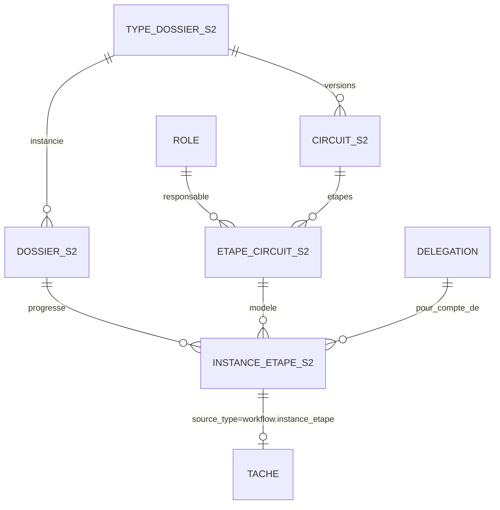

# ALPHA — Conception du sprint 1 « Socle »

| Rubrique | Valeur |
|---|---|
| Référence | ALPHA-ARCH-S1 |
| Sources | ALPHA-CDC-V2 (12/10/2026), prototype HTML (écrans 01, 01b, 01c, 01d, 12, 13, 18) |
| Sprint | Semaine 1 · 5 → 11 novembre 2026 |
| Stack | Django 5.1 + DRF 3.15, PostgreSQL 16, Celery 5 + Redis 7, Next.js 15 (App Router, TypeScript), Mailpit, docker-compose |
| Destinataires | agents backend, frontend, tests, devops |

Conventions du document :
- les noms de tables, de champs et d'API sont en français, en snake_case, sans accents ;
- toute table métier porte `etablissement_id` ; on dit « table tenant » ;
- « S2 » et « S3 » désignent ce qui est anticipé pour les sprints 2 et 3 et **ne doit pas être implémenté** au sprint 1.

---

## 1. Arborescence du dépôt et applications Django

```
alpha/
├── docker-compose.yml               # services communs (db, redis, backend, worker, beat, frontend)
├── docker-compose.override.yml      # dev : mailpit, ports exposés, volumes de code, runserver / next dev
├── docker-compose.recette.yml       # recette : caddy, images construites, pas de volumes de code
├── docker-compose.prod.yml          # production : idem recette + limites de ressources
├── .env.example                     # toutes les variables, sans valeurs secrètes
├── .gitattributes                   # * text=auto eol=lf (indispensable sous Windows pour les scripts shell)
├── .editorconfig
├── scripts/
│   ├── dev.ps1                      # Windows : up, down, migrate, test, seed, logs, shell
│   ├── dev.sh                       # même chose pour Linux / WSL / CI
│   ├── deploy.sh                    # déploiement VPS (pull, migrate, up -d)
│   └── backup.sh                    # pg_dump chiffré (age) + envoi hors site
├── infra/
│   ├── postgres/
│   │   ├── init/01-roles.sh         # crée alpha_owner, alpha_app, la base ; exécuté au 1er démarrage
│   │   └── postgresql.conf          # réglages VPS (shared_buffers, etc.)
│   └── caddy/Caddyfile              # TLS auto, /api → backend, / → frontend, en-têtes de sécurité
├── backend/
│   ├── Dockerfile                   # python:3.12-slim, multi-stage, utilisateur non root
│   ├── pyproject.toml               # dépendances (voir 1.2) + ruff + pytest
│   ├── manage.py
│   ├── config/
│   │   ├── settings/{base,dev,test,recette,prod}.py
│   │   ├── urls.py                  # /api/v1/… ; /api/v1/schema/ ; /api/v1/docs/ (dev et recette)
│   │   ├── celery.py
│   │   └── wsgi.py
│   ├── alpha/
│   │   ├── core/                    # contexte de requête, erreurs API, chiffrement de champ, pagination, permissions de base
│   │   ├── tenancy/                 # Etablissement, ParametresEtablissement, middleware de contexte, TenantModel, SQL RLS
│   │   ├── comptes/                 # Utilisateur, connexion, MFA, codes de secours, jetons, sessions, téléphone perdu
│   │   ├── organisation/            # unités (périmètres), catalogue des rôles, affectations, codes de permission
│   │   ├── delegations/             # absences et délégations
│   │   ├── taches/                  # boîte « À traiter » générique
│   │   ├── notifications/           # préférences, notifications in-app, e-mails (gabarits FR)
│   │   ├── audit/                   # journal chaîné, triggers, contrôle d'intégrité
│   │   └── plateforme/              # console super-administrateur FYXOP
│   └── tests/                       # tests transverses (isolation, RLS, sécurité) ; tests unitaires dans chaque app
├── frontend/
│   ├── Dockerfile                   # node:20-alpine, build "standalone"
│   ├── package.json
│   ├── next.config.ts               # rewrites /api → backend en dev ; output: "standalone"
│   ├── tailwind.config.ts           # jetons de la charte (section 7.3)
│   ├── src/
│   │   ├── app/                     # routes (section 7.1)
│   │   ├── components/{ui,shell,auth,taches,compte,admin,audit,console}/
│   │   ├── lib/api/{client.ts,schema.d.ts,hooks/}   # schema.d.ts généré depuis l'OpenAPI
│   │   ├── lib/{format.ts,permissions.ts}
│   │   └── middleware.ts            # redirection vers /connexion si pas de cookie de session
│   └── e2e/                         # Playwright
├── docs/
│   ├── sources/                     # CDC, prototype
│   └── architecture-sprint1.md      # ce document
└── .github/workflows/ci.yml
```

### 1.1 Applications Django (package `alpha.*`)

| App | Rôle au sprint 1 | Modèles |
|---|---|---|
| `core` | utilitaires transverses : `contexte` (contextvars : tenant, portée, utilisateur, IP, request_id), format d'erreur, `ChampChiffre`, pagination, `StepUpTOTP` | — |
| `tenancy` | établissements, contexte tenant, RLS | `Etablissement`, `ParametresEtablissement` |
| `comptes` | identité, authentification, MFA, sessions | `Utilisateur`, `AuthenticatorTOTP`, `CodeSecours`, `JetonUsageUnique`, `SessionAppareil`, `HistoriqueMotDePasse`, `SignalementTelephonePerdu` |
| `organisation` | périmètres et catalogue des rôles | `UniteOrganisationnelle`, `Role`, `AffectationRole` |
| `delegations` | absences avec délégation | `Absence`, `Delegation` |
| `taches` | boîte « À traiter » | `Tache` |
| `notifications` | préférences et notifications | `PreferencesNotification`, `Notification` |
| `audit` | journal en ajout seul | `EvenementAudit`, `ControleIntegriteAudit` |
| `plateforme` | console FYXOP | aucun modèle propre (utilise `Etablissement`, `Utilisateur` plateforme, `EvenementAudit`) |

Réservées, à ne pas créer au sprint 1 : `workflow`, `dossiers`, `documents` (S2) ; `rh`, `tresorerie`, `contrats`, `gouvernance`, `fiscal`, `pme`, `externes` (S3).

L'admin Django (`django.contrib.admin`) n'est **pas** monté : il contournerait la logique de contexte tenant. Les modèles `auth.Group` et `auth.Permission` ne sont pas utilisés (`Utilisateur` hérite de `AbstractBaseUser` sans `PermissionsMixin`).

### 1.2 Dépendances principales

Backend : `django~=5.1`, `djangorestframework~=3.15`, `drf-spectacular`, `psycopg[binary]~=3.2`, `django-environ`, `argon2-cffi`, `pyotp`, `segno` (QR SVG), `cryptography` (MultiFernet), `celery[redis]`, `django-redis`, `openpyxl` (export du journal), `user-agents`, `gunicorn`. Dev/test : `pytest-django`, `factory-boy`, `freezegun`, `ruff`, `mypy` (optionnel).

Frontend : `next@15`, `react@19`, `typescript`, `@tanstack/react-query`, `react-hook-form`, `zod`, `tailwindcss`, `openapi-typescript`, `@playwright/test`, `otplib` (E2E uniquement).

### 1.3 Services docker-compose

| Service | Image | Dev | Recette / prod | Notes |
|---|---|---|---|---|
| `db` | `postgres:16-alpine` | port 127.0.0.1:5432 | réseau interne | volume `pgdata` ; `infra/postgres/init` monté sur `/docker-entrypoint-initdb.d` |
| `redis` | `redis:7-alpine` | interne | interne | cache, sessions (`cached_db`), limitation de débit, broker Celery |
| `migrate` | image backend | `manage.py migrate` | idem, avant `backend` | **se connecte avec `alpha_owner`** ; `depends_on: db (healthy)` ; `restart: "no"` |
| `backend` | image backend | `runserver 0.0.0.0:8000` | `gunicorn -w 3 --threads 2` | se connecte avec `alpha_app` ; `depends_on: migrate (completed_successfully)` |
| `worker` | image backend | `celery worker -c 2` | idem | `alpha_app` |
| `beat` | image backend | `celery beat` | idem | planification (section 6.5) |
| `frontend` | image frontend | `next dev` port 3000 | `node server.js` | dev : `WATCHPACK_POLLING=true` si le code est sur le disque Windows |
| `mailpit` | `axllent/mailpit` | SMTP 1025, UI 127.0.0.1:8025 | absent | recette : SMTP réel ou Mailpit protégé (point ouvert) |
| `caddy` | `caddy:2-alpine` | absent | 80/443 | TLS 1.2+ ; `/api/*` → backend ; reste → frontend |

En dev, le navigateur parle uniquement à `http://localhost:3000` ; Next.js réécrit `/api/:path*` vers `http://backend:8000/api/:path*`. En recette et production, Caddy sert front et API sur la **même origine** (`https://app.<domaine>`), ce qui permet des cookies `SameSite=Lax` sans CORS.

Poste Windows : cloner le dépôt **dans le système de fichiers WSL2** (`\\wsl$\Ubuntu\home\…`) et utiliser Docker Desktop en mode WSL2 ; c'est nettement plus rapide que les montages depuis `C:\` et évite les problèmes de surveillance de fichiers. `node_modules` est un volume anonyme du conteneur, jamais monté depuis l'hôte. `scripts/dev.ps1` encapsule `docker compose` pour PowerShell.

VPS Hostinger KVM 2 (2 vCPU, 8 Go) : recette et production sont deux projets compose distincts (`-p alpha-recette`, `-p alpha-prod`), avec réseaux, volumes, bases, secrets et sous-domaines séparés. Budget mémoire prod ≈ 4,5 Go (Postgres 2 Go avec `shared_buffers=512MB`, backend 1 Go, worker 512 Mo, frontend 512 Mo, Redis 256 Mo), recette ≈ 2 Go.

---

## 2. Modèle de données

### 2.1 Conventions communes

- Clé primaire `id uuid` (générée par Django, `uuid4`), sauf `evenement_audit` (`bigint` identité).
- Horodatages `timestamptz` ; `USE_TZ=True`, `TIME_ZONE="Africa/Dakar"`.
- Énumérations : `varchar` + contrainte `CHECK` (générée par `models.TextChoices` + `CheckConstraint`).
- Montants : `numeric(18,2)` ; devise `char(3)`, `XOF` par défaut.
- Toute table tenant : `etablissement_id uuid NOT NULL REFERENCES etablissement(id) ON DELETE RESTRICT`, index en tête de chaque index composite, RLS activée et forcée (section 3).
- Extensions : `citext`, `btree_gist` (toutes deux « trusted », créées par `alpha_owner` dans la migration `tenancy.0001`).

### 2.2 Tables

#### `etablissement` (app tenancy)

| Champ | Type | Contraintes |
|---|---|---|
| id | uuid | PK |
| code | varchar(40) | UNIQUE, `^[a-z0-9-]+$` (ex. `banque-demo`) |
| raison_sociale | varchar(200) | NOT NULL |
| type | varchar(10) | CHECK IN (`BANQUE`,`SFD`,`PME`) |
| pays | char(2) | défaut `SN` |
| statut | varchar(15) | CHECK IN (`ACTIF`,`LECTURE_SEULE`,`SUSPENDU`,`ARCHIVE`) ; défaut `ACTIF` (anticipe la facturation, CDC §7) |
| fuseau_horaire | varchar(40) | défaut `Africa/Dakar` |
| cree_le, modifie_le | timestamptz | NOT NULL |
| cree_par_id | uuid | FK `utilisateur` (super-admin), NULL |

Index : `UNIQUE(code)`. RLS : politique spécifique (3.4).

#### `parametres_etablissement` (tenancy, 1–1)

| Champ | Type | Contraintes / défaut |
|---|---|---|
| etablissement_id | uuid | PK et FK `etablissement` |
| inactivite_session_min | smallint | 15, CHECK 5–60 |
| duree_max_session_h | smallint | 12, CHECK 1–24 |
| mdp_longueur_min | smallint | 12, CHECK ≥ 12 |
| mdp_historique | smallint | 5 |
| tentatives_max | smallint | 5 |
| verrouillage_min | smallint | 15 |
| validite_invitation_h | smallint | 72 |
| retention_audit_annees | smallint | 10 |
| modules_actifs | text[] | dérivé du type (S2/S3 : menu par module) |
| modifie_le | timestamptz | |

#### `utilisateur` (comptes, `AUTH_USER_MODEL`)

| Champ | Type | Contraintes |
|---|---|---|
| id | uuid | PK |
| etablissement_id | uuid | FK, **NULL uniquement pour un super-admin** |
| est_super_admin | boolean | défaut false ; CHECK `(etablissement_id IS NULL) = est_super_admin` |
| email | citext | **UNIQUE global** (hypothèse H1 : pas de sélection d'établissement à la connexion) |
| prenom, nom | varchar(80) | NOT NULL |
| telephone_mobile | varchar(20) | format E.164, NULL |
| langue | varchar(2) | `fr`/`en`, défaut `fr` |
| password | varchar(128) | Argon2id (format Django) ; vide tant que statut `INVITE` |
| statut | varchar(12) | CHECK IN (`INVITE`,`ACTIF`,`SUSPENDU`,`DESACTIVE`) |
| responsable_id | uuid | FK `utilisateur` même établissement, NULL (valide les absences) |
| mfa_a_reconfigurer | boolean | défaut false (après téléphone perdu) |
| signature_bloquee | boolean | défaut false (téléphone perdu ; lu par la signature S2) |
| echecs_connexion | smallint | défaut 0 |
| verrouille_jusqua | timestamptz | NULL |
| verrouillages_24h | smallint | défaut 0 ; à 3 → verrouillage jusqu'à déblocage administrateur |
| bloque_par_admin | boolean | défaut false |
| derniere_connexion | timestamptz | NULL |
| mdp_modifie_le | timestamptz | NULL |
| active_le | timestamptz | NULL |
| cree_le, modifie_le | timestamptz | |
| cree_par_id | uuid | FK `utilisateur`, NULL |

Index : `UNIQUE(email)`, `(etablissement_id, statut)`, `(etablissement_id, nom, prenom)`, `(responsable_id)`.

#### `authenticator_totp` (comptes)

| Champ | Type | Contraintes |
|---|---|---|
| id | uuid | PK |
| etablissement_id | uuid | FK, NULL pour super-admin |
| utilisateur_id | uuid | FK `utilisateur` ON DELETE CASCADE |
| secret_chiffre | bytea | jeton MultiFernet du secret base32 (160 bits) |
| cle_version | smallint | version de clé (rotation) |
| libelle | varchar(80) | ex. « iPhone de Cheikh », facultatif |
| statut | varchar(10) | CHECK IN (`EN_ATTENTE`,`ACTIF`,`SUSPENDU`,`REVOQUE`) |
| dernier_pas | bigint | dernier compteur TOTP accepté (anti-rejeu), NULL |
| cree_le, confirme_le, revoque_le | timestamptz | |

Index : `UNIQUE(utilisateur_id) WHERE statut IN ('ACTIF','SUSPENDU')` (un seul Authenticator actif ou suspendu), `(utilisateur_id, statut)`.

#### `code_secours` (comptes)

| Champ | Type | Contraintes |
|---|---|---|
| id | uuid | PK |
| etablissement_id | uuid | FK, NULL pour super-admin |
| utilisateur_id | uuid | FK CASCADE |
| lot | uuid | identifiant de génération ; une nouvelle génération invalide les lots précédents |
| code_hmac | char(64) | HMAC-SHA256(poivre, code normalisé) |
| utilise_le | timestamptz | NULL |
| invalide_le | timestamptz | NULL |

Index : `UNIQUE(utilisateur_id, code_hmac)`, `(utilisateur_id) WHERE utilise_le IS NULL AND invalide_le IS NULL`. 10 codes par lot, format `XXXX-XXXX` (alphabet Crockford base32, 40 bits). Le HMAC suffit (codes à forte entropie, tentatives limitées) et permet une recherche indexée.

#### `jeton_usage_unique` (comptes)

| Champ | Type | Contraintes |
|---|---|---|
| id | uuid | PK |
| etablissement_id | uuid | FK, NULL pour super-admin |
| utilisateur_id | uuid | FK CASCADE |
| objet | varchar(20) | CHECK IN (`INVITATION`,`REINIT_MDP`,`REENROLEMENT_MFA`) |
| jeton_hash | char(64) | SHA-256 du jeton ; UNIQUE |
| etape | varchar(20) | progression de l'activation : `CREE`,`MDP_OK`,`TOTP_EN_ATTENTE`,`TOTP_OK` |
| expire_le | timestamptz | NOT NULL |
| utilise_le, annule_le | timestamptz | NULL |
| cree_par_id | uuid | FK `utilisateur`, NULL |
| cree_le | timestamptz | |

Le jeton en clair (32 octets, base64url) n'existe que dans l'e-mail. Émettre un nouveau jeton du même objet annule les précédents.

#### `session_appareil` (comptes)

| Champ | Type | Contraintes |
|---|---|---|
| id | uuid | PK |
| etablissement_id | uuid | FK, NULL pour super-admin |
| utilisateur_id | uuid | FK CASCADE |
| cle_session_hash | char(64) | SHA-256 de la clé de session Django ; UNIQUE |
| appareil | varchar(120) | « Chrome · Windows 11 » (via `user-agents`) |
| user_agent | text | |
| ip | inet | |
| methode_mfa | varchar(12) | `TOTP` ou `CODE_SECOURS` |
| cree_le, derniere_activite, expire_le | timestamptz | `expire_le` = création + durée max |
| revoque_le | timestamptz | NULL |
| motif_fin | varchar(20) | `DECONNEXION`,`INACTIVITE`,`EXPIRATION`,`REVOCATION_UTILISATEUR`,`REVOCATION_ADMIN`,`TELEPHONE_PERDU`,`MDP_CHANGE` |

Index : `(utilisateur_id, revoque_le)`, `(etablissement_id, derniere_activite)`.

#### `historique_mot_de_passe` (comptes)

`id uuid PK`, `etablissement_id`, `utilisateur_id FK CASCADE`, `password varchar(128)`, `cree_le`. Index `(utilisateur_id, cree_le DESC)`. On conserve les `mdp_historique` derniers.

#### `signalement_telephone_perdu` (comptes)

| Champ | Type | Contraintes |
|---|---|---|
| id | uuid | PK |
| etablissement_id | uuid | FK NOT NULL |
| utilisateur_id | uuid | FK |
| canal | varchar(15) | `PAGE_PUBLIQUE`,`MON_COMPTE`,`ADMIN` |
| statut | varchar(15) | CHECK IN (`OUVERT`,`REINITIALISE`,`ANNULE`) |
| signale_le | timestamptz | |
| traite_par_id | uuid | FK `utilisateur` (administrateur, ≠ `utilisateur_id`), NULL |
| mode_verification | varchar(20) | `PRESENTIEL_PIECE`,`RAPPEL_TELEPHONIQUE`,`VISIO`,`AUTRE`, NULL |
| commentaire | text | |
| traite_le | timestamptz | NULL |

Index : `UNIQUE(utilisateur_id) WHERE statut='OUVERT'`, `(etablissement_id, statut)`. CHECK `traite_par_id IS NULL OR traite_par_id <> utilisateur_id`.

#### `unite_organisationnelle` (organisation)

| Champ | Type | Contraintes |
|---|---|---|
| id | uuid | PK |
| etablissement_id | uuid | FK |
| parent_id | uuid | FK self, NULL |
| type | varchar(12) | `DIRECTION`,`SERVICE`,`AGENCE`,`COMITE` |
| code | varchar(40) | |
| libelle | varchar(150) | ex. « Dakar-Plateau », « Direction des engagements », « Comité de crédit » |
| actif | boolean | |
| cree_le, modifie_le | timestamptz | |

Index : `UNIQUE(etablissement_id, code)`, `(etablissement_id, parent_id)`. Les sous-arbres sont résolus en Python (quelques centaines d'unités au plus), mis en cache Redis par établissement.

#### `role` — catalogue des rôles (organisation)

| Champ | Type | Contraintes |
|---|---|---|
| id | uuid | PK |
| etablissement_id | uuid | FK |
| code | varchar(50) | slug ; UNIQUE par établissement |
| libelle | varchar(100) | UNIQUE `(etablissement_id, lower(libelle))` |
| description | text | |
| permissions | text[] | codes de permission système (2.3) ; défaut `{}` |
| est_systeme | boolean | rôle « Administrateur ALPHA » : non supprimable, permissions non retirables |
| actif | boolean | |
| ordre | smallint | ordre d'affichage |
| cree_le, modifie_le | timestamptz | |

Index : `UNIQUE(etablissement_id, code)`, `UNIQUE(etablissement_id, lower(libelle))`, `GIN(permissions)`. Pas de suppression physique : désactivation seulement (S2 : interdite si un circuit publié utilise le rôle).

#### `affectation_role` (organisation)

| Champ | Type | Contraintes |
|---|---|---|
| id | uuid | PK |
| etablissement_id | uuid | FK |
| utilisateur_id | uuid | FK |
| role_id | uuid | FK `role` ON DELETE RESTRICT |
| unite_id | uuid | FK `unite_organisationnelle`, NULL = tout l'établissement |
| principal | boolean | rôle affiché dans les listes |
| debut | date | défaut aujourd'hui |
| fin | date | NULL = en cours |
| cree_par_id | uuid | FK |
| cree_le | timestamptz | |

Contraintes : `UNIQUE(utilisateur_id) WHERE principal AND fin IS NULL` ; `UNIQUE(utilisateur_id, role_id, unite_id) WHERE fin IS NULL` (avec `NULLS NOT DISTINCT`, PG 15+). Index : `(etablissement_id, role_id) WHERE fin IS NULL` (titulaires d'un rôle, détection du rôle vacant).

Un utilisateur peut cumuler plusieurs affectations (ex. DAF et membre du comité) ; l'invitation en crée exactement une, principale.

#### `absence` (delegations)

| Champ | Type | Contraintes |
|---|---|---|
| id | uuid | PK |
| etablissement_id | uuid | FK |
| utilisateur_id | uuid | FK |
| debut, fin | timestamptz | CHECK `fin > debut` |
| motif | varchar(12) | `CONGE`,`MISSION`,`FORMATION`,`MALADIE`,`AUTRE` |
| commentaire | text | |
| statut | varchar(10) | `SOUMISE`,`VALIDEE`,`REFUSEE`,`ANNULEE` |
| valideur_id | uuid | FK `utilisateur`, NULL (fixé à la soumission : `responsable_id`, sinon un administrateur) |
| decide_le | timestamptz | NULL |
| motif_refus | text | |
| cree_le | timestamptz | |

Index : `(etablissement_id, utilisateur_id, debut)`, `(valideur_id) WHERE statut='SOUMISE'`.

#### `delegation` (delegations)

| Champ | Type | Contraintes |
|---|---|---|
| id | uuid | PK |
| etablissement_id | uuid | FK |
| origine | varchar(10) | `ABSENCE` (S1) ; `POUVOIR` réservé S2/S3 (barème des délégations, CDC §4.8) |
| absence_id | uuid | FK `absence`, NULL si origine `POUVOIR` |
| delegant_id | uuid | FK `utilisateur` |
| delegataire_id | uuid | FK `utilisateur` ; CHECK `delegataire_id <> delegant_id` |
| role_id | uuid | FK `role`, NULL = tous les rôles du délégant |
| debut, fin | timestamptz | CHECK `fin > debut` |
| statut | varchar(12) | `EN_ATTENTE`,`ACTIVE`,`TERMINEE`,`ANNULEE`,`REFUSEE` |
| portee | jsonb | `{}` au S1 ; S2 : `{"types_dossier": [...], "plafond_montant": "..."}` |
| cree_le | timestamptz | |

Contrainte d'exclusion (btree_gist) : `EXCLUDE USING gist (delegant_id WITH =, COALESCE(role_id, '00000000-0000-0000-0000-000000000000'::uuid) WITH =, tstzrange(debut, fin) WITH &&) WHERE (statut IN ('EN_ATTENTE','ACTIVE'))`. Index : `(delegataire_id, debut, fin) WHERE statut='ACTIVE'`.

Une délégation est **effective** quand `statut='ACTIVE' AND now() BETWEEN debut AND fin`. Le statut passe à `ACTIVE` à la validation de l'absence ; la tâche planifiée `cloturer_delegations` passe à `TERMINEE` après `fin`.

#### `tache` — boîte « À traiter » (taches)

| Champ | Type | Contraintes |
|---|---|---|
| id | uuid | PK |
| etablissement_id | uuid | FK |
| module | varchar(20) | `COMPTE`,`ADMINISTRATION` (S1) ; `CREDIT`,`INTERNE`,`RH`,`TRESORERIE`,`CONTRATS`,`GOUVERNANCE`,`FISCAL`,`PME_FOURNISSEURS`,`PME_BUDGET`,`PME_COMMERCIAL` (S2/S3) |
| source_type | varchar(60) | ex. `delegations.absence`, `comptes.signalement` ; S2 : `workflow.instance_etape` |
| source_id | uuid | |
| reference | varchar(40) | ex. `ED-2026-0077` (affichée en Mono) |
| titre | varchar(200) | ex. « 40 postes informatiques » |
| sous_titre | varchar(300) | ex. « demandé par Babacar Diouf » |
| montant | numeric(18,2) | NULL |
| devise | char(3) | `XOF` |
| action | varchar(12) | `DECIDER`,`SIGNER`,`VALIDER`,`COMPLETER`,`TRAITER` (libellé du bouton) |
| type_echeance | varchar(12) | `AVANT`,`ECHEANCE`,`EXECUTION`,`PREAVIS` (« Avant le », « Échéance le », « Exécution le », « Préavis avant le ») |
| echeance | timestamptz | NULL = « Plus tard » |
| assigne_utilisateur_id | uuid | FK `utilisateur`, NULL |
| assigne_role_id | uuid | FK `role`, NULL |
| assigne_unite_id | uuid | FK `unite_organisationnelle`, NULL |
| demandeur_id | uuid | FK `utilisateur`, NULL |
| lien | varchar(300) | route frontend relative (ex. `/administration/utilisateurs/…`) |
| statut | varchar(10) | `OUVERTE`,`TERMINEE`,`ANNULEE` |
| resultat | varchar(30) | ex. `VALIDEE`,`REFUSEE` |
| cree_le | timestamptz | |
| terminee_le | timestamptz | NULL |
| terminee_par_id | uuid | FK, NULL |
| pour_compte_de_id | uuid | FK, NULL : délégant si l'action a été faite par délégation |

Contraintes : CHECK `assigne_utilisateur_id IS NOT NULL OR assigne_role_id IS NOT NULL` ; `UNIQUE(source_type, source_id, action) WHERE statut='OUVERTE'` (idempotence). Index : `(etablissement_id, statut, echeance)`, `(assigne_utilisateur_id) WHERE statut='OUVERTE'`, `(assigne_role_id, assigne_unite_id) WHERE statut='OUVERTE'`.

**Règle de visibilité** (`Tache.objects.visibles_pour(u)`) : tâche ouverte et
1. `assigne_utilisateur_id = u` ; ou
2. `assigne_role_id` ∈ rôles actifs de `u` et (`assigne_unite_id` NULL ou dans le sous-arbre d'une unité d'affectation de `u` pour ce rôle) ; ou
3. règles 1 ou 2 appliquées à tout délégant `d` ayant une délégation effective vers `u` (limitée à `role_id` si renseigné).

Une tâche visible par délégation porte l'indicateur `par_delegation_de` dans l'API.

**Regroupement par urgence**, calculé côté serveur dans le fuseau de l'établissement : `EN_RETARD` (`echeance < now`), `AUJOURDHUI` (même date locale), `CETTE_SEMAINE` (jusqu'au dimanche 23:59 local), `PLUS_TARD` (au-delà ou `echeance` NULL). Tri : groupe, puis `echeance` croissante, puis `cree_le`.

**Service à utiliser par les modules** (seul point d'écriture, S2 compris) : `taches.services.ouvrir(source, *, module, action, titre, …)`, `terminer(source, action, par, resultat)`, `annuler(source)`, `reassigner(tache, …)`. Chaque appel écrit un événement d'audit et déclenche une notification.

#### `preferences_notification` (notifications, 1–1 avec utilisateur)

| Champ | Type | Défaut |
|---|---|---|
| utilisateur_id | uuid | PK, FK |
| etablissement_id | uuid | FK |
| email | boolean | true |
| push | boolean | false (« Téléphone » : PWA, envoi S4) |
| sms | boolean | false (envoi S4, passerelle à choisir) |
| resume_quotidien | boolean | false |
| heure_resume | time | 07:30 |
| par_evenement | jsonb | `{}` (surcharges par type, réservé) |
| modifie_le | timestamptz | |

Les alertes de sécurité (nouvelle connexion, verrouillage, téléphone perdu, mot de passe changé) partent toujours par e-mail et ne sont pas désactivables.

#### `notification` (notifications, in-app : cloche du bandeau)

`id uuid PK`, `etablissement_id`, `utilisateur_id FK`, `type varchar(40)`, `titre varchar(200)`, `corps text`, `lien varchar(300)`, `lue_le timestamptz NULL`, `cree_le`. Index `(utilisateur_id, lue_le, cree_le DESC)`.

#### `evenement_audit` (audit) — détail en section 6

| Champ | Type | Contraintes |
|---|---|---|
| id | bigint | PK, `GENERATED ALWAYS AS IDENTITY` |
| etablissement_id | uuid | FK, NULL = chaîne plateforme |
| seq | bigint | NOT NULL, fixé par trigger |
| horodatage | timestamptz | NOT NULL |
| acteur_type | varchar(12) | `UTILISATEUR`,`SUPER_ADMIN`,`SYSTEME`,`API`,`IA`,`ANONYME` |
| acteur_id | uuid | NULL |
| acteur_libelle | varchar(150) | instantané (« Awa Diop », « Admin FYXOP », « inconnu ») |
| categorie | varchar(15) | `CONNEXION`,`DECISION`,`MODIFICATION`,`PARAMETRAGE`,`ACCES_API`,`SUPER_ADMIN`,`SECURITE`,`DOCUMENT`,`ENVOI_EXTERNE`,`IA` |
| action | varchar(60) | code, ex. `auth.connexion.echec` |
| objet_type | varchar(60) | ex. `comptes.utilisateur` |
| objet_id | varchar(64) | |
| objet_libelle | varchar(200) | ex. `CR-2026-0412`, `m.sow@…` |
| avant, apres | jsonb | NULL ; valeurs JSON simples uniquement (pas de flottants) |
| detail | text | |
| ip | inet | NULL |
| user_agent | varchar(300) | |
| request_id | uuid | |
| payload_canonique | text | NOT NULL |
| hash_precedent | char(64) | fixé par trigger |
| hash | char(64) | fixé par trigger |

Index : `UNIQUE(COALESCE(etablissement_id, '00000000-0000-0000-0000-000000000000'::uuid), seq)`, `(etablissement_id, horodatage DESC)`, `(etablissement_id, categorie, horodatage DESC)`, `(etablissement_id, acteur_id, horodatage DESC)`, `(etablissement_id, objet_type, objet_id)`.

#### `controle_integrite_audit` (audit)

`id uuid PK`, `etablissement_id NULL`, `lance_le`, `termine_le`, `declencheur varchar(10)` (`PLANIFIE`,`MANUEL`), `statut varchar(10)` (`EN_COURS`,`INTACTE`,`ROMPUE`,`ERREUR`), `nb_evenements bigint`, `dernier_seq bigint`, `dernier_hash char(64)`, `premier_seq_invalide bigint NULL`, `message text`. Index `(etablissement_id, lance_le DESC)`. Chaque contrôle réussi sert d'**ancre** : le contrôle suivant vérifie que `(dernier_seq, dernier_hash)` de l'ancre existe toujours, ce qui détecte une troncature de fin de chaîne.

#### Tables Django techniques (sans RLS)

`django_migrations`, `django_content_type`, `django_session` (données de session : identifiants seulement), `django_celery_beat_*` si utilisé (sinon planification dans `config/celery.py`). `alpha_app` y a les droits nécessaires ; aucune donnée métier n'y est stockée.

### 2.3 Codes de permission (stockés dans `role.permissions`)

| Code | Accès |
|---|---|
| `admin.utilisateurs` | inviter, modifier, suspendre, déverrouiller, traiter « téléphone perdu » |
| `admin.roles` | catalogue des rôles, habilitations |
| `admin.organisation` | unités / périmètres |
| `admin.securite` | paramètres de sécurité de l'établissement |
| `admin.absences` | voir et valider toute absence (à défaut de responsable) |
| `audit.lecture` | consulter le journal |
| `audit.export` | exporter le journal (Excel) |

Rôles système semés à la création d'un établissement : « Administrateur ALPHA » (`est_systeme`, tous les `admin.*`), « Auditeur interne » (`audit.*`). Le reste du catalogue par défaut est semé selon le type (`BANQUE`/`SFD` : agent de saisie, analyste crédit, responsable crédit, membre du comité, chef de service, contrôle de gestion, achats, comptable, responsable RH, juriste, DAF, directeur général, secrétaire du conseil, collaborateur ; `PME` : directeur général, DAF, contrôleur de gestion, comptable fournisseurs, responsable achats, directrice commerciale, chef de service, responsable RH, secrétaire du conseil, collaborateur), sans permission système : ces rôles serviront aux circuits S2. Invariant : il reste toujours au moins un utilisateur `ACTIF` titulaire de `admin.utilisateurs` (refus 409 sinon).

### 2.4 Diagramme ER (sprint 1)

```mermaid
erDiagram
    ETABLISSEMENT ||--|| PARAMETRES_ETABLISSEMENT : "a"
    ETABLISSEMENT ||--o{ UTILISATEUR : "emploie"
    ETABLISSEMENT ||--o{ UNITE_ORGANISATIONNELLE : "structure"
    ETABLISSEMENT ||--o{ ROLE : "catalogue"
    ETABLISSEMENT ||--o{ EVENEMENT_AUDIT : "chaine"
    UNITE_ORGANISATIONNELLE ||--o{ UNITE_ORGANISATIONNELLE : "parent"
    UTILISATEUR ||--o{ UTILISATEUR : "responsable"
    UTILISATEUR ||--o{ AFFECTATION_ROLE : "detient"
    ROLE ||--o{ AFFECTATION_ROLE : "attribue"
    UNITE_ORGANISATIONNELLE ||--o{ AFFECTATION_ROLE : "perimetre"
    UTILISATEUR ||--o{ AUTHENTICATOR_TOTP : "enrole"
    UTILISATEUR ||--o{ CODE_SECOURS : "possede"
    UTILISATEUR ||--o{ JETON_USAGE_UNIQUE : "recoit"
    UTILISATEUR ||--o{ SESSION_APPAREIL : "ouvre"
    UTILISATEUR ||--o{ HISTORIQUE_MOT_DE_PASSE : "a"
    UTILISATEUR ||--o{ SIGNALEMENT_TELEPHONE_PERDU : "signale"
    UTILISATEUR ||--o{ ABSENCE : "declare"
    ABSENCE ||--o{ DELEGATION : "genere"
    UTILISATEUR ||--o{ DELEGATION : "delegant"
    UTILISATEUR ||--o{ DELEGATION : "delegataire"
    ROLE ||--o{ DELEGATION : "limite_a"
    UTILISATEUR ||--o{ TACHE : "assignee"
    ROLE ||--o{ TACHE : "assignee_role"
    UNITE_ORGANISATIONNELLE ||--o{ TACHE : "perimetre"
    UTILISATEUR ||--|| PREFERENCES_NOTIFICATION : "regle"
    UTILISATEUR ||--o{ NOTIFICATION : "recoit"
    ETABLISSEMENT ||--o{ CONTROLE_INTEGRITE_AUDIT : "verifie"

    ETABLISSEMENT {
        uuid id PK
        string code UK
        string type
        string statut
    }
    UTILISATEUR {
        uuid id PK
        uuid etablissement_id FK
        citext email UK
        string statut
        bool est_super_admin
        bool signature_bloquee
    }
    ROLE {
        uuid id PK
        uuid etablissement_id FK
        string code
        string_array permissions
        bool est_systeme
    }
    AFFECTATION_ROLE {
        uuid id PK
        uuid utilisateur_id FK
        uuid role_id FK
        uuid unite_id FK
        bool principal
    }
    AUTHENTICATOR_TOTP {
        uuid id PK
        uuid utilisateur_id FK
        bytea secret_chiffre
        string statut
        bigint dernier_pas
    }
    DELEGATION {
        uuid id PK
        uuid delegant_id FK
        uuid delegataire_id FK
        uuid role_id FK
        timestamptz debut
        timestamptz fin
        jsonb portee
    }
    TACHE {
        uuid id PK
        string module
        string source_type
        uuid source_id
        uuid assigne_utilisateur_id FK
        uuid assigne_role_id FK
        timestamptz echeance
        string statut
    }
    EVENEMENT_AUDIT {
        bigint id PK
        uuid etablissement_id FK
        bigint seq
        text payload_canonique
        char hash_precedent
        char hash
    }
```



### 2.5 Anticipation S2/S3 (à ne pas implémenter)



Ce que le sprint 1 garantit pour les sprints suivants :
- `role.id` est la cible des étapes de circuit (FK `PROTECT`) ; un rôle sans affectation active est détectable par l'index `(etablissement_id, role_id) WHERE fin IS NULL` → blocage d'étape (CDC §2.5).
- `unite_organisationnelle` porte périmètres, agences et comités (`type=COMITE`, membres = affectations sur le rôle « Membre du comité ») ; S2 ajoutera `affectation_role_type_dossier` pour le périmètre par type de dossier (CDC §3.2).
- `delegation.origine='POUVOIR'` et `portee` couvriront le barème des délégations ; `tache.pour_compte_de_id` trace l'action déléguée.
- `tache` reste le seul point d'entrée de la boîte : le moteur S2 n'appelle que `taches.services`.
- `utilisateur.signature_bloquee` et le step-up TOTP (5.1) seront réutilisés par la signature des décisions.
- Fichiers (S2) : stockage sous `/<etablissement_id>/…`, chemin construit uniquement depuis le contexte tenant.

---

## 3. Stratégie multi-tenant

Deux barrières indépendantes : (1) filtrage applicatif automatique par le contexte de requête ; (2) Row Level Security PostgreSQL. Une erreur dans l'une est rattrapée par l'autre ; les tests vérifient chacune séparément.

### 3.1 Rôles PostgreSQL

| Rôle | Attributs | Usage |
|---|---|---|
| `postgres` | superuser | uniquement le script d'init du conteneur |
| `alpha_owner` | `LOGIN NOSUPERUSER NOCREATEROLE BYPASSRLS` (+ `CREATEDB` en dev/CI seulement, pour la base de test) | propriétaire de la base, du schéma et des tables ; **uniquement** le service `migrate` et les commandes d'exploitation |
| `alpha_app` | `LOGIN NOSUPERUSER NOCREATEROLE NOCREATEDB NOBYPASSRLS` | backend, worker, beat ; **jamais propriétaire** d'aucune table, donc soumis à la RLS |

`infra/postgres/init/01-roles.sh` (lit `ALPHA_OWNER_PASSWORD`, `ALPHA_APP_PASSWORD`) :

```sql
CREATE ROLE alpha_owner LOGIN PASSWORD :'owner_pwd' NOSUPERUSER NOCREATEROLE BYPASSRLS;
CREATE ROLE alpha_app   LOGIN PASSWORD :'app_pwd'   NOSUPERUSER NOCREATEROLE NOCREATEDB NOBYPASSRLS;
CREATE DATABASE alpha OWNER alpha_owner;
```

Les droits (stockés par base, donc à rejouer dans la base de test) sont posés par la **migration `tenancy.0001`**, exécutée par `alpha_owner` :

```sql
CREATE EXTENSION IF NOT EXISTS citext;
CREATE EXTENSION IF NOT EXISTS btree_gist;
REVOKE ALL ON SCHEMA public FROM PUBLIC;
GRANT USAGE ON SCHEMA public TO alpha_app;
ALTER DEFAULT PRIVILEGES FOR ROLE alpha_owner IN SCHEMA public
  GRANT SELECT, INSERT, UPDATE, DELETE ON TABLES TO alpha_app;
ALTER DEFAULT PRIVILEGES FOR ROLE alpha_owner IN SCHEMA public
  GRANT USAGE, SELECT ON SEQUENCES TO alpha_app;
ALTER DEFAULT PRIVILEGES FOR ROLE alpha_owner IN SCHEMA public
  REVOKE EXECUTE ON FUNCTIONS FROM PUBLIC;          -- EXECUTE accordé fonction par fonction
```

Le nom du rôle applicatif vient du setting `ALPHA_DB_APP_ROLE` (défaut `alpha_app`) et est injecté dans les `RunSQL`.

### 3.2 Variables de session PostgreSQL et fonctions d'accès

| Variable | Valeurs | Positionnée par |
|---|---|---|
| `app.current_tenant` | uuid ou `''` | middleware, tâches Celery, `contexte_tenant()` |
| `app.scope` | `tenant`, `platform`, `worker`, `anonymous` | idem |
| `app.current_user` | uuid ou `''` | middleware (utilisé par les politiques plateforme) |

Toujours en **local à la transaction** (`set_config(…, true)`) : la valeur disparaît au `COMMIT`/`ROLLBACK`, donc aucune fuite d'un établissement à l'autre via une connexion persistante (`CONN_MAX_AGE=60`).

```sql
CREATE FUNCTION app_current_tenant() RETURNS uuid LANGUAGE sql STABLE AS
$$ SELECT NULLIF(current_setting('app.current_tenant', true), '')::uuid $$;
CREATE FUNCTION app_scope() RETURNS text LANGUAGE sql STABLE AS
$$ SELECT COALESCE(NULLIF(current_setting('app.scope', true), ''), 'anonymous') $$;
CREATE FUNCTION app_current_user() RETURNS uuid LANGUAGE sql STABLE AS
$$ SELECT NULLIF(current_setting('app.current_user', true), '')::uuid $$;
GRANT EXECUTE ON FUNCTION app_current_tenant(), app_scope(), app_current_user() TO alpha_app;
```

Sans contexte, `app_current_tenant()` vaut NULL et toute politique `etablissement_id = app_current_tenant()` renvoie **zéro ligne** : le système échoue fermé.

### 3.3 Middleware et contexte applicatif

Ordre dans `MIDDLEWARE` :

```
SecurityMiddleware
SessionMiddleware
alpha.core.middleware.RequestIdMiddleware          # request_id, IP réelle (X-Forwarded-For de Caddy, 1 proxy de confiance)
alpha.tenancy.middleware.TenantContextMiddleware   # ouvre la transaction et pose le contexte
CsrfViewMiddleware
AuthenticationMiddleware
alpha.comptes.middleware.SessionActiviteMiddleware # révocation, inactivité, durée max (section 4.8)
alpha.tenancy.middleware.StatutEtablissementMiddleware  # SUSPENDU → 403, LECTURE_SEULE → 423 sur écriture
```

```python
# alpha/tenancy/middleware.py
class TenantContextMiddleware:
    def __call__(self, request):
        tenant_id = request.session.get("tenant_id")      # posé à la connexion
        scope = request.session.get("scope", "anonymous")  # "tenant" | "platform"
        user_id = request.session.get("_auth_user_id")
        with transaction.atomic():                         # transaction la plus externe de la requête
            appliquer_contexte(tenant_id, scope, user_id)  # SELECT set_config(...,true) x3 + contextvars
            response = self.get_response(request)
            if getattr(response, "streaming", False):
                raise ImproperlyConfigured("pas de réponse streaming sous contexte tenant")
        return response
```

- `ATOMIC_REQUESTS = True` en plus : la vue tourne dans un point de sauvegarde imbriqué ; quand DRF lève une `APIException`, seul ce point de sauvegarde est annulé.
- **Règle** : les vues d'authentification **retournent** des `Response(401/423)` au lieu de lever une exception, sinon l'événement d'audit d'échec serait annulé avec la vue.
- `alpha.core.contexte` expose `tenant_courant()`, `scope_courant()`, `utilisateur_courant()`, `ip()`, `request_id()` (contextvars, compatibles threads gunicorn).
- `contexte_tenant(etablissement_id, scope="tenant")` est un gestionnaire de contexte qui repose `set_config` (et rétablit la valeur précédente à la sortie) ; il sert à la connexion (le tenant n'est connu qu'après résolution de l'e-mail), aux tâches Celery et aux opérations de provisionnement du super-admin.

### 3.4 Modèles et managers

```python
# alpha/tenancy/models.py
class TenantManager(models.Manager):
    def get_queryset(self):
        tid = contexte.tenant_courant()
        if tid is None:
            raise TenantNonDefini()                 # fail closed côté application
        return super().get_queryset().filter(etablissement_id=tid)

class TenantModel(models.Model):
    etablissement = models.ForeignKey("tenancy.Etablissement", on_delete=models.RESTRICT, editable=False)
    objects = TenantManager()
    objets_globaux = models.Manager()               # réservé : migrations de données, commandes d'exploitation
    class Meta:
        abstract = True
    def save(self, *a, **kw):
        tid = contexte.tenant_courant()
        if self.etablissement_id is None:
            self.etablissement_id = tid
        elif self.etablissement_id != tid:
            raise ViolationTenant()
        super().save(*a, **kw)
```

- Toutes les tables tenant héritent de `TenantModel`. `Utilisateur` utilise un manager équivalent qui accepte le cas plateforme.
- `objets_globaux` est interdit dans les vues ; un test (ruff, règle personnalisée ou `grep` en CI) vérifie qu'il n'apparaît que dans `management/`, `migrations/` et `plateforme/services.py`. Même s'il est utilisé à tort, la RLS ne renvoie que les lignes du tenant courant.
- Le `_base_manager` de Django (accès par relation) n'est pas filtré par l'application : c'est la RLS qui couvre ce cas.
- Les vues DRF héritent de `TenantViewSet` (queryset via `objects`, `perform_create` sans `etablissement` dans le corps : le champ n'est jamais accepté en entrée).

### 3.5 Politiques RLS

Helper de migration `alpha.tenancy.rls.activer_rls(table)` → `RunSQL` :

```sql
ALTER TABLE {t} ENABLE ROW LEVEL SECURITY;
ALTER TABLE {t} FORCE ROW LEVEL SECURITY;
CREATE POLICY isolation_tenant ON {t} FOR ALL TO alpha_app
  USING (etablissement_id = app_current_tenant())
  WITH CHECK (etablissement_id = app_current_tenant());
```

Appliqué à : `parametres_etablissement`, `code_secours`*, `jeton_usage_unique`*, `session_appareil`*, `authenticator_totp`*, `historique_mot_de_passe`*, `signalement_telephone_perdu`, `unite_organisationnelle`, `role`, `affectation_role`, `absence`, `delegation`, `tache`, `preferences_notification`*, `notification`*.

(*) Tables pouvant contenir des lignes de super-admin (`etablissement_id` NULL) : politique « tenant ou plateforme » :

```sql
CREATE POLICY isolation_tenant_ou_plateforme ON {t} FOR ALL TO alpha_app
  USING (etablissement_id = app_current_tenant()
         OR (etablissement_id IS NULL AND app_scope() = 'platform' AND utilisateur_id = app_current_user()))
  WITH CHECK (etablissement_id = app_current_tenant()
         OR (etablissement_id IS NULL AND app_scope() = 'platform' AND utilisateur_id = app_current_user()));
```

`utilisateur` :

```sql
CREATE POLICY isolation_utilisateur ON utilisateur FOR ALL TO alpha_app
  USING (etablissement_id = app_current_tenant()
         OR (etablissement_id IS NULL AND app_scope() = 'platform'))
  WITH CHECK (etablissement_id = app_current_tenant()
         OR (etablissement_id IS NULL AND app_scope() = 'platform'));
```

`etablissement` (ni `DELETE` ni `TRUNCATE` accordés à `alpha_app`) :

```sql
REVOKE DELETE, TRUNCATE ON etablissement FROM alpha_app;
CREATE POLICY lecture_etablissement ON etablissement FOR SELECT TO alpha_app
  USING (id = app_current_tenant() OR app_scope() IN ('platform', 'worker'));
CREATE POLICY ecriture_etablissement ON etablissement FOR INSERT TO alpha_app
  WITH CHECK (app_scope() = 'platform');
CREATE POLICY maj_etablissement ON etablissement FOR UPDATE TO alpha_app
  USING (app_scope() = 'platform') WITH CHECK (app_scope() = 'platform');
```

`evenement_audit` : voir 6.3.

**Fonctions `SECURITY DEFINER`** (propriétaire `alpha_owner`, `SET search_path = public, pg_temp`, `REVOKE ALL FROM PUBLIC`, `GRANT EXECUTE TO alpha_app`) : ce sont les seuls passages contrôlés à travers les établissements, et ils ne renvoient que des identifiants.

```sql
-- connexion : résoudre l'établissement à partir de l'e-mail (avant tout contexte)
CREATE FUNCTION alpha_resoudre_connexion(p_email citext)
RETURNS TABLE(utilisateur_id uuid, etablissement_id uuid, est_super_admin boolean)
LANGUAGE sql STABLE SECURITY DEFINER SET search_path = public, pg_temp AS
$$ SELECT id, etablissement_id, est_super_admin FROM utilisateur WHERE email = p_email $$;

-- liens e-mail : résoudre un jeton (activation, réinitialisation, réenrôlement)
CREATE FUNCTION alpha_resoudre_jeton(p_hash char(64))
RETURNS TABLE(jeton_id uuid, etablissement_id uuid, utilisateur_id uuid, objet varchar)
LANGUAGE sql STABLE SECURITY DEFINER SET search_path = public, pg_temp AS
$$ SELECT id, etablissement_id, utilisateur_id, objet FROM jeton_usage_unique
   WHERE jeton_hash = p_hash AND utilise_le IS NULL AND annule_le IS NULL AND expire_le > now() $$;

-- console FYXOP : agrégats techniques, sans contenu
CREATE FUNCTION alpha_stats_etablissements()
RETURNS TABLE(etablissement_id uuid, nb_utilisateurs_actifs int, nb_invites int,
              derniere_activite timestamptz, nb_evenements_audit_30j bigint, dernier_controle_statut varchar)
LANGUAGE sql STABLE SECURITY DEFINER SET search_path = public, pg_temp AS $$ … $$;
-- garde : la fonction lève une exception si app_scope() <> 'platform'
```

Après résolution, le code applicatif appelle `contexte_tenant(etablissement_id)` puis relit l'utilisateur **par le chemin normal** (manager + RLS).

**Test de couverture** (`tests/test_rls_couverture.py`) : interroge `pg_class`/`pg_policies` et échoue si une table possédant une colonne `etablissement_id` n'a pas `relrowsecurity AND relforcerowsecurity` et au moins une politique. Une table ajoutée au S2 sans RLS fait donc échouer la CI.

### 3.6 Migrations

- Exécutées **uniquement** par le service `migrate`, connecté en `alpha_owner` (`DATABASE_URL_OWNER`). Le backend n'a pas les droits DDL.
- `alpha_owner` a `BYPASSRLS` : les migrations de schéma et les migrations de données traversent les établissements sans poser de contexte. `FORCE ROW LEVEL SECURITY` reste utile : si un jour le propriétaire perd `BYPASSRLS`, il est soumis aux politiques au lieu d'en être exempté silencieusement.
- Chaque migration qui crée une table tenant inclut `activer_rls()` dans la **même** migration.
- Les migrations de données utilisent `objets_globaux` et ne déclenchent pas d'envoi (ni e-mail ni tâche Celery).

### 3.7 Tâches de fond (Celery)

```python
@tache_tenant(queue="defaut")                 # décorateur alpha.tenancy.celery
def envoyer_email_invitation(etablissement_id, jeton_id): ...
# le décorateur : with transaction.atomic(): with contexte_tenant(etablissement_id, scope="tenant"): …
```

- Toute tâche liée à un établissement reçoit `etablissement_id` en **premier argument** ; jamais d'objet ORM sérialisé.
- Les tâches transverses (planifiées) ouvrent `contexte_tenant(None, scope="worker")`, ce qui ne donne accès qu'à la **liste** des établissements (politique `lecture_etablissement`), puis rappellent une tâche par établissement (`verifier_chaine_audit.delay(etab_id)`).
- Les envois d'e-mails sont planifiés par `transaction.on_commit(...)` : aucun e-mail pour une transaction annulée.
- Le worker se connecte en `alpha_app`, comme le backend.

### 3.8 Super-administrateur FYXOP

- Compte `utilisateur` avec `est_super_admin=true`, `etablissement_id NULL`, créé **uniquement** par `manage.py creer_super_admin --email …` (lien d'activation envoyé ; MFA obligatoire, comme tout le monde).
- Session : `scope="platform"`, `tenant_id` absent. Inactivité 10 min (non paramétrable), durée max 8 h.
- Accès aux données : `TenantManager` lève `TenantNonDefini` et la RLS renvoie zéro ligne sur toutes les tables tenant ; les permissions DRF `EstUtilisateurEtablissement` refusent (403) toutes les routes hors `/plateforme/`.
- Les vues plateforme ne lisent que `etablissement`, les utilisateurs plateforme, la chaîne d'audit plateforme et `alpha_stats_etablissements()`.
- Seules opérations écrivant dans un établissement, toutes dans `plateforme/services.py` sous `contexte_tenant(cible)` : `provisionner_etablissement` (paramètres, rôles par défaut, unité racine, invitation du premier administrateur), `inviter_administrateur`, `changer_statut`. Chacune est journalisée **deux fois** : dans la chaîne plateforme et dans la chaîne de l'établissement (`acteur_type=SUPER_ADMIN`, catégorie `SUPER_ADMIN`), comme la ligne « Admin FYXOP · Super-admin » du prototype.

---

## 4. Flux d'authentification

### 4.1 Choix : session par cookie httpOnly + CSRF (pas de JWT)

Le seul client du sprint 1 est le navigateur, servi sur la **même origine** que l'API. Un cookie de session httpOnly n'est pas lisible par JavaScript (donc pas volable par XSS) et la révocation côté serveur est immédiate, ce qu'exigent « téléphone perdu », « appareils et sessions » et l'expiration d'inactivité. Avec un JWT, il faudrait une liste de révocation et des jetons de rafraîchissement, donc un état serveur, avec plus de surface d'attaque. Les intégrations machine (Core Banking, S4) auront leur propre authentification (clés API ou OAuth 2.0 client credentials) via une classe DRF séparée.

Paramètres : cookie `alpha_sid` (`HttpOnly`, `Secure` hors dev, `SameSite=Lax`, `Path=/`), `SESSION_ENGINE="django.contrib.sessions.backends.cached_db"`, `SESSION_EXPIRE_AT_BROWSER_CLOSE=True` ; cookie `alpha_csrf` (lisible par JS, `SameSite=Lax`), en-tête `X-CSRFToken`. Les vues anonymes de `/auth/` sont décorées `csrf_protect` (protection contre le login CSRF) ; `GET /auth/csrf` pose le cookie.

### 4.2 Connexion + MFA

1. Le front appelle `GET /auth/csrf`, puis `POST /auth/connexion {email, mot_de_passe}`.
2. Limitation de débit Redis : 10/min par IP et 20/h par e-mail (clé = HMAC de l'e-mail). Dépassement → 429.
3. `alpha_resoudre_connexion(email)`. E-mail inconnu → hachage Argon2 factice (temps constant), audit `auth.connexion.echec` dans la **chaîne plateforme** (acteur `ANONYME`, objet = e-mail masqué `m.sow@…`), réponse 401 `IDENTIFIANTS_INVALIDES`.
4. `contexte_tenant(etab)` ; chargement de l'utilisateur. Refus avec la **même réponse 401** si : statut ≠ `ACTIF`, `verrouille_jusqua > now`, `bloque_par_admin`, établissement `SUSPENDU` (dans ce dernier cas, 403 `ETABLISSEMENT_SUSPENDU`, car l'utilisateur doit savoir que l'accès est coupé).
5. Vérification Argon2. Échec → `echecs_connexion += 1` ; à `tentatives_max` (5) : `verrouille_jusqua = now + 15 min`, `verrouillages_24h += 1`, e-mail d'alerte « compte verrouillé » ; au 3e verrouillage en 24 h : `bloque_par_admin = true`. Audit `auth.connexion.echec` (motif `MOT_DE_PASSE`) ou `auth.verrouillage`. Réponse 401.
6. Succès du mot de passe → la session reçoit l'état **pré-authentifié** : `preauth = {user_id, tenant_id, scope, expire: now+5min, essais_mfa: 0}`. Aucun `login()` Django à ce stade. Si `mfa_a_reconfigurer` → réponse `{etape: "REENROLEMENT_REQUIS"}` (l'utilisateur doit passer par le lien de réenrôlement, 4.5). Sinon → `200 {etape: "MFA_REQUIS"}`.
7. `POST /auth/mfa {code}` (6 chiffres) **ou** `{code_secours}`. Limite 5/min par session.
8. Vérification TOTP : `pyotp.TOTP(secret).verify` avec fenêtre ±1 pas ; on calcule le compteur accepté et on refuse s'il est `≤ dernier_pas` (anti-rejeu), sinon `dernier_pas = compteur`. Un Authenticator `SUSPENDU` (téléphone perdu) est refusé ; seuls les codes de secours restent utilisables.
9. Code de secours : normalisation (majuscules, sans tiret ni espace), recherche par `code_hmac` parmi les codes non utilisés et non invalidés, puis `utilise_le = now` (`SELECT … FOR UPDATE`). Audit `mfa.code_secours_utilise` ; e-mail d'information ; s'il reste ≤ 2 codes, le front invite à les régénérer.
10. Échec → compte dans `echecs_connexion` (même verrouillage qu'en 5), audit `auth.connexion.echec` (motif `MFA`, objet = e-mail masqué) ; réponse 401 `CODE_INVALIDE {tentatives_restantes}` ; à 0 → 423 `COMPTE_VERROUILLE {jusqua}` et la pré-authentification est effacée.
11. Succès → `request.session.cycle_key()` (anti-fixation), `login()`, `session["tenant_id"]`, `session["scope"]="tenant"` (ou `platform`), `session["mfa_le"]=now`, création de `session_appareil`, remise à zéro de `echecs_connexion`, `derniere_connexion=now`. Audit `auth.connexion.succes` (« Connexion réussie · double authentification OK »).
12. **Connexion inhabituelle** : si aucun `session_appareil` des 90 derniers jours n'a la même famille navigateur + OS **et** le même préfixe IP /16 → e-mail « Nouvelle connexion à votre compte ALPHA » (appareil, IP, heure, lien « Ce n'était pas moi » vers `/activation?onglet=telephone-perdu`) et audit `SECURITE`.
13. Réponse `200 {utilisateur: Moi}` ; le front redirige vers `/a-traiter` (ou `/console` pour un super-admin).

### 4.3 Activation du compte par invitation

1. L'administrateur appelle `POST /admin/utilisateurs {email, prenom, nom, role_id, unite_id?, responsable_id?, telephone_mobile?}`. Le rôle doit être actif et appartenir au catalogue de l'établissement (sinon 400 `ROLE_HORS_CATALOGUE`).
2. Création de `utilisateur` (statut `INVITE`, mot de passe inutilisable), de l'`affectation_role` principale et de `preferences_notification` par défaut ; jeton `INVITATION` valable `validite_invitation_h` (72 h). Audit `utilisateur.invite`. E-mail (après commit) avec le lien `https://app/activation?jeton=<jeton>`.
3. `GET /auth/activation/{jeton}` → `alpha_resoudre_jeton` → contexte tenant → `200 {prenom, etablissement, role, etape}` (« Bienvenue, Cheikh. L'administrateur de l'Établissement démo vous a invité comme Analyste crédit »). Jeton invalide ou expiré → 410 `JETON_INVALIDE`.
4. **Étape « Mot de passe »** : `POST /auth/activation/{jeton}/mot-de-passe {mot_de_passe, confirmation}` → politique (4.9) → hachage Argon2 enregistré, `jeton.etape = MDP_OK`. Le compte reste `INVITE` (non utilisable) tant que le MFA n'est pas confirmé.
5. **Étape « Téléphone »** : `POST /auth/activation/{jeton}/authenticator` → génération d'un secret base32 de 160 bits, `authenticator_totp` en `EN_ATTENTE` (secret chiffré), retour `{qr_svg, secret_affichable: "JBSW Y3DP …", emetteur: "ALPHA (Établissement démo)"}`. L'URI `otpauth://totp/ALPHA%20(Établissement%20démo):c.badiane@…?secret=…&issuer=…&digits=6&period=30` est encodé en QR SVG (segno) côté serveur ; le secret n'est **jamais** journalisé. Rappeler l'appel régénère le secret (l'ancien en attente est révoqué).
6. **Étape « Vérification »** : `POST /auth/activation/{jeton}/authenticator/confirmer {code}` → vérification TOTP (5 essais, puis jeton annulé et nouvelle invitation nécessaire) → Authenticator `ACTIF`, génération de 10 codes de secours (lot), réponse `200 {codes_secours: [...]}`, affichés **une seule fois** (copie, téléchargement `.txt`, impression).
7. `POST /auth/activation/{jeton}/terminer {codes_conserves: true}` → `utilisateur.statut = ACTIF`, `active_le = now`, `jeton.utilise_le = now`, connexion ouverte comme en 4.2 (étapes 11 à 13). Audit `utilisateur.active` et `mfa.active`. Le front redirige vers `/a-traiter`.

### 4.4 Codes de secours

1. Génération : 10 codes `XXXX-XXXX` (`secrets.choice` sur l'alphabet Crockford), HMAC-SHA256 avec le poivre `ALPHA_HMAC_POIVRE` ; tout lot antérieur reçoit `invalide_le = now`.
2. Usage : uniquement à l'étape MFA de la connexion (4.2, étape 9) et comme preuve dans la réinitialisation de mot de passe (4.7). **Pas** pour la signature des décisions (S2).
3. Régénération par l'utilisateur : `POST /moi/codes-secours {code}` (step-up TOTP obligatoire) → 10 nouveaux codes affichés une fois. Audit `mfa.codes_regeneres`.
4. Mon compte affiche le nombre de codes restants, jamais les codes eux-mêmes.

### 4.5 Téléphone perdu

**Signalement** (bloque immédiatement la signature, CDC §4.6) :
1. Depuis la page publique (onglet « Téléphone perdu » de `/activation`) : `POST /auth/telephone-perdu {email, mot_de_passe}`. Limite 3/h par IP. Réponse toujours `202` (pas d'information sur l'existence du compte). Si le mot de passe est faux, on compte un échec (4.2, étape 5) et on ne fait rien d'autre.
   Depuis Mon compte (utilisateur connecté, ex. sur son PC) : `POST /moi/telephone-perdu`.
2. Transaction unique : `utilisateur.signature_bloquee = true` ; Authenticator `ACTIF` → `SUSPENDU` ; `signalement_telephone_perdu` `OUVERT` ; **toutes les sessions révoquées** (`motif_fin=TELEPHONE_PERDU`), y compris la session courante si le signalement vient de Mon compte ; tâche « À traiter » `module=ADMINISTRATION`, `action=TRAITER`, `assigne_role_id` = rôle(s) portant `admin.utilisateurs`, `titre="Téléphone perdu · <Nom>"`, `echeance = now + 1 jour ouvré`. Audit `telephone.signale` (catégorie `SECURITE`). E-mails à l'utilisateur et aux administrateurs.
3. Tant que le dossier est ouvert, l'utilisateur peut encore se connecter avec un **code de secours** pour consulter et travailler ; toute signature (S2) est refusée (`SIGNATURE_BLOQUEE`).

**Réinitialisation par l'administrateur après vérification d'identité** :
4. Un administrateur **autre que l'intéressé** vérifie l'identité hors ligne (présentiel avec pièce d'identité, rappel au numéro connu, visio), puis appelle `POST /admin/signalements-telephone/{id}/reinitialiser {mode_verification, commentaire, code_totp}` (step-up TOTP de l'administrateur). S'il n'existe pas d'autre administrateur : point ouvert P4 (super-admin FYXOP).
5. Effets : Authenticator `REVOQUE`, codes de secours invalidés, `mfa_a_reconfigurer = true`, signalement `REINITIALISE` (`traite_par_id`, `mode_verification`), tâche terminée, jeton `REENROLEMENT_MFA` de 24 h envoyé par e-mail. Audit `telephone.reinitialise` avec le mode de vérification.
6. **Réenrôlement** par l'utilisateur via `/reenrolement/{jeton}` : `POST /auth/reenrolement/{jeton}/mot-de-passe {mot_de_passe}` (vérification du mot de passe **actuel**, pas de définition), puis `…/authenticator`, `…/authenticator/confirmer`, `…/terminer`, comme les étapes 5 à 7 de 4.3. À la fin : `signature_bloquee = false`, `mfa_a_reconfigurer = false`, connexion ouverte. Audit `mfa.reenrole`.

**Changement de téléphone sans perte** (Mon compte) : `POST /moi/authenticator/changement {code_actuel}` → nouveau secret `EN_ATTENTE` + QR ; `POST /moi/authenticator/changement/confirmer {code_nouveau}` → ancien `REVOQUE`, nouveau `ACTIF` ; les codes de secours sont conservés. E-mail d'alerte. Audit `mfa.change`.

### 4.6 Déconnexion

`POST /auth/deconnexion` → `session_appareil.revoque_le = now` (`DECONNEXION`), `logout()`. Audit `auth.deconnexion`.

### 4.7 Réinitialisation du mot de passe

1. `POST /auth/mot-de-passe/oubli {email}` → toujours `202`. Limites : 3/h par e-mail, 10/h par IP. Si le compte existe et est `ACTIF` : jeton `REINIT_MDP` de 30 min (les précédents sont annulés), e-mail avec le lien `/reinitialisation/{jeton}`. Audit `auth.mdp.oubli_demande`.
2. `GET /auth/mot-de-passe/reinitialisation/{jeton}` → `200 {email_masque}` ou 410.
3. `POST /auth/mot-de-passe/reinitialisation/{jeton} {mot_de_passe, confirmation, code | code_secours}` → **preuve MFA exigée** : un accès à la seule boîte e-mail ne suffit pas. Sans Authenticator ni code de secours, il faut passer par « Téléphone perdu ».
4. Contrôle de la politique et de l'historique → mot de passe enregistré, entrée dans `historique_mot_de_passe`, `mdp_modifie_le`, **révocation de toutes les sessions** (`MDP_CHANGE`), remise à zéro du verrouillage, jeton consommé. E-mail « Votre mot de passe a été modifié ». Audit `auth.mdp.reinitialise`. Réponse 204 ; le front renvoie vers `/connexion`.

Changement volontaire dans Mon compte : `POST /moi/mot-de-passe {actuel, nouveau, confirmation, code}` → mêmes contrôles ; révoque les **autres** sessions.

### 4.8 Sessions, inactivité, appareils

`SessionActiviteMiddleware`, pour toute requête authentifiée :
1. Recherche du `session_appareil` par `sha256(session_key)` (cache Redis de 60 s).
2. Absent ou `revoque_le` renseigné → `flush()` et 401 `SESSION_EXPIREE`.
3. `now - derniere_activite > inactivite_session_min` → révocation `INACTIVITE`, audit `auth.session.expiree`, 401.
4. `now > expire_le` (durée max 12 h) → révocation `EXPIRATION`, 401.
5. Sinon, mise à jour de `derniere_activite`, au plus une écriture par minute.

Les appels de fond du front (compteurs de la boîte, notifications) envoient l'en-tête `X-Alpha-Fond: 1` et **ne prolongent pas** l'inactivité. Le front affiche un avertissement 60 s avant l'expiration (« Votre session va expirer », bouton « Rester connecté » = `GET /auth/session`).

### 4.9 Mot de passe et chiffrement

- `PASSWORD_HASHERS = ["django.contrib.auth.hashers.Argon2PasswordHasher"]` (Argon2id, paramètres par défaut de Django 5) ; aucun autre hacheur accepté.
- Validateurs : longueur ≥ 12 (`mdp_longueur_min`) ; au moins 3 catégories sur 4 (minuscule, majuscule, chiffre, symbole) ; `UserAttributeSimilarityValidator` sur prénom, nom et e-mail ; `CommonPasswordValidator` ; `NumericPasswordValidator` ; différent des 5 derniers (`historique_mot_de_passe`) ; refus des suites de 4 chiffres ressemblant à une année de naissance (`19xx`, `20xx`). Le front affiche « 12 caractères minimum. Évitez votre nom et votre date de naissance. » et l'avancement de chaque règle.
- Secret TOTP chiffré au repos : `MultiFernet` sur `ALPHA_CLES_CHIFFREMENT` (liste de clés base64 ; la première chiffre, toutes déchiffrent). `cle_version` permet la commande `manage.py rechiffrer_secrets`. Les clés ne sont jamais en base ni dans l'image (variables d'environnement / fichier secret Docker).
- Step-up TOTP (`alpha.core.permissions.StepUpTOTP`) : les actions sensibles exigent un champ `code` TOTP valide dans le corps (changement de téléphone, régénération des codes, changement de mot de passe, réinitialisation « téléphone perdu » par l'administrateur, paramètres de sécurité). Le même mécanisme servira à la signature des décisions (S2).

---

## 5. Contrat d'API REST v1

Base : `/api/v1`. JSON UTF-8. Schéma OpenAPI généré par drf-spectacular : `/api/v1/schema/` ; Swagger : `/api/v1/docs/` (dev et recette uniquement au S1).

**Erreurs** : `{"code": "IDENTIFIANTS_INVALIDES", "message": "Adresse e-mail ou mot de passe incorrect.", "details": {...}}`. Erreurs de validation : 400 `VALIDATION`, `details = {"champ": ["message"]}`. Codes HTTP : 400, 401 (non authentifié / session expirée), 403 (permission), 404 (inexistant **ou autre établissement** : jamais 403 pour un objet d'un autre tenant), 409 (conflit métier), 410 (jeton), 423 (verrouillage / lecture seule), 429 (débit).

**Pagination** : `?page=1&taille=25` (max 100) → `{count, next, previous, results}` ; journal d'audit en curseur `?curseur=` → `{next, results}`.

**Permissions** : `Anonyme` ; `Session` = utilisateur d'établissement authentifié avec MFA ; `Perm(x)` = Session + code `x` dans l'un de ses rôles actifs ; `StepUp` = code TOTP requis dans le corps ; `SuperAdmin` = session plateforme.

### 5.1 Objets de référence

```jsonc
// Moi
{ "id": "uuid", "prenom": "Abdou", "nom": "Kane", "initiales": "AK", "email": "a.kane@etablissement-demo.sn",
  "telephone_mobile": "+221770000000", "langue": "fr",
  "etablissement": { "id": "uuid", "raison_sociale": "Établissement démo", "type": "BANQUE", "statut": "ACTIF" },
  "role_principal": { "id": "uuid", "libelle": "DAF", "unite": "Direction administrative et financière" },
  "affectations": [ { "role": {"id": "uuid", "libelle": "DAF"}, "unite": {"id": "uuid", "libelle": "…"} | null, "principal": true } ],
  "permissions": ["audit.lecture"], "modules": ["COMPTE", "ADMINISTRATION"],
  "signature_bloquee": false, "inactivite_session_min": 15, "est_super_admin": false }

// UtilisateurListe (admin)
{ "id": "uuid", "prenom": "Awa", "nom": "Diop", "initiales": "AD", "email": "a.diop@…",
  "role_principal": "Analyste crédit", "perimetre": "Dakar-Plateau · crédit particuliers",
  "authenticator": "ACTIVE" | "NON_CONFIGUREE" | "SUSPENDUE",
  "derniere_connexion": "2026-10-10T08:02:00Z" | null,
  "statut": "ACTIF" | "INVITE" | "SUSPENDU" | "DESACTIVE", "verrouille": false }

// Role
{ "id": "uuid", "code": "analyste-credit", "libelle": "Analyste crédit", "description": "…",
  "permissions": [], "est_systeme": false, "actif": true, "ordre": 2, "nb_titulaires": 3, "vacant": false }

// Tache
{ "id": "uuid", "module": "INTERNE", "module_libelle": "Décisions internes", "reference": "ED-2026-0077",
  "titre": "40 postes informatiques", "sous_titre": "demandé par Babacar Diouf",
  "montant": "14600000.00", "devise": "XOF", "action": "DECIDER", "action_libelle": "Décider",
  "type_echeance": "AVANT", "echeance": "2026-10-14T23:59:59Z",
  "groupe": "EN_RETARD" | "AUJOURDHUI" | "CETTE_SEMAINE" | "PLUS_TARD",
  "retard_jours": 1, "lien": "/…", "par_delegation_de": null | { "id": "uuid", "nom": "Mamadou Sow" } }

// EvenementAudit
{ "seq": 1284, "horodatage": "2026-10-10T20:31:07.123456Z", "acteur_type": "UTILISATEUR", "acteur_libelle": "Awa Diop",
  "categorie": "DECISION", "action": "…", "action_libelle": "Décision", "objet_type": "…", "objet_id": "…",
  "objet_libelle": "CR-2026-0412", "avant": {"avis": null}, "apres": {"avis": "favorable sous condition"},
  "detail": "Avis : — → favorable sous condition", "ip": "10.20.4.17", "hash": "a41f…", "hash_court": "a41f…9c2e" }
```

### 5.2 Authentification (`/auth`)

| Méthode | Chemin | Corps | Réponses | Perm. |
|---|---|---|---|---|
| GET | `/auth/csrf` | — | 204 (cookie `alpha_csrf`) | Anonyme |
| GET | `/auth/session` | — | 200 `Moi` · 401 | Anonyme |
| POST | `/auth/connexion` | `{email, mot_de_passe}` | 200 `{etape: "MFA_REQUIS" \| "REENROLEMENT_REQUIS"}` · 401 `IDENTIFIANTS_INVALIDES` · 403 `ETABLISSEMENT_SUSPENDU` · 429 | Anonyme |
| POST | `/auth/mfa` | `{code}` ou `{code_secours}` | 200 `{utilisateur: Moi, codes_secours_restants}` · 401 `CODE_INVALIDE {tentatives_restantes}` · 401 `PREAUTH_EXPIREE` · 423 `COMPTE_VERROUILLE {jusqua}` | Pré-auth |
| POST | `/auth/deconnexion` | — | 204 | Session |
| GET | `/auth/activation/{jeton}` | — | 200 `{prenom, etablissement, role, etape}` · 410 | Anonyme |
| POST | `/auth/activation/{jeton}/mot-de-passe` | `{mot_de_passe, confirmation}` | 204 · 400 `VALIDATION` | Anonyme |
| POST | `/auth/activation/{jeton}/authenticator` | — | 200 `{qr_svg, secret_affichable, emetteur, compte}` · 409 `ETAPE_INVALIDE` | Anonyme |
| POST | `/auth/activation/{jeton}/authenticator/confirmer` | `{code}` | 200 `{codes_secours: [10]}` · 401 `CODE_INVALIDE` | Anonyme |
| POST | `/auth/activation/{jeton}/terminer` | `{codes_conserves: true}` | 200 `Moi` (session ouverte) | Anonyme |
| GET | `/auth/reenrolement/{jeton}` | — | 200 `{prenom, etablissement}` · 410 | Anonyme |
| POST | `/auth/reenrolement/{jeton}/mot-de-passe` | `{mot_de_passe}` (vérifie l'actuel) | 204 · 401 | Anonyme |
| POST | `/auth/reenrolement/{jeton}/authenticator` | — | comme activation | Anonyme |
| POST | `/auth/reenrolement/{jeton}/authenticator/confirmer` | `{code}` | 200 `{codes_secours}` | Anonyme |
| POST | `/auth/reenrolement/{jeton}/terminer` | `{codes_conserves: true}` | 200 `Moi` | Anonyme |
| POST | `/auth/mot-de-passe/oubli` | `{email}` | 202 | Anonyme |
| GET | `/auth/mot-de-passe/reinitialisation/{jeton}` | — | 200 `{email_masque}` · 410 | Anonyme |
| POST | `/auth/mot-de-passe/reinitialisation/{jeton}` | `{mot_de_passe, confirmation, code \| code_secours}` | 204 · 400 · 401 `CODE_INVALIDE` · 410 | Anonyme |
| POST | `/auth/telephone-perdu` | `{email, mot_de_passe}` | 202 | Anonyme |

### 5.3 Mon compte (`/moi`)

| Méthode | Chemin | Corps | Réponses | Perm. |
|---|---|---|---|---|
| GET | `/moi` | — | 200 `Moi` | Session |
| PATCH | `/moi` | `{prenom?, nom?, telephone_mobile?, langue?}` (e-mail non modifiable) | 200 `Moi` | Session |
| POST | `/moi/mot-de-passe` | `{actuel, nouveau, confirmation, code}` | 204 · 400 · 401 | Session + StepUp |
| GET | `/moi/securite` | — | 200 `{authenticator: {statut, libelle, active_le}, codes_secours_restants, signature_bloquee, signalement: {statut, signale_le} \| null, mdp_modifie_le}` | Session |
| POST | `/moi/authenticator/changement` | `{code_actuel}` | 200 `{qr_svg, secret_affichable}` | Session + StepUp |
| POST | `/moi/authenticator/changement/confirmer` | `{code_nouveau}` | 204 · 401 | Session |
| POST | `/moi/codes-secours` | `{code}` | 200 `{codes_secours: [10]}` | Session + StepUp |
| POST | `/moi/telephone-perdu` | `{}` | 202 (la session est révoquée) | Session |
| GET | `/moi/sessions` | — | 200 `[{id, appareil, ip, methode_mfa, cree_le, derniere_activite, courante}]` | Session |
| DELETE | `/moi/sessions/{id}` | — | 204 · 404 | Session |
| POST | `/moi/sessions/revoquer-autres` | — | 200 `{revoquees: n}` | Session |
| GET | `/moi/absences` | `?statut=` | 200 page `[Absence + delegation]` | Session |
| POST | `/moi/absences` | `{debut, fin, motif, commentaire?, delegataire_id, role_id?}` | 201 · 400 · 409 `CHEVAUCHEMENT` | Session |
| POST | `/moi/absences/{id}/annuler` | — | 200 | Session (avant `debut` ; ensuite, `fin` est avancée à maintenant) |
| GET | `/moi/delegataires-possibles` | `?q=` | 200 `[{id, nom, role_principal}]` (actifs, même établissement, hors soi) | Session |
| GET | `/moi/delegations-recues` | — | 200 `[{delegant, role, debut, fin, statut}]` | Session |
| GET | `/moi/preferences-notification` | — | 200 `{email, push, sms, resume_quotidien, heure_resume}` | Session |
| PUT | `/moi/preferences-notification` | idem | 200 | Session |
| GET | `/moi/notifications` | `?non_lues=1` | 200 page `[{id, type, titre, corps, lien, lue_le, cree_le}]` + `non_lues` | Session |
| POST | `/moi/notifications/{id}/lue` · `/moi/notifications/tout-lu` | — | 204 | Session |

### 5.4 À traiter (`/taches`) et absences

| Méthode | Chemin | Corps / paramètres | Réponses | Perm. |
|---|---|---|---|---|
| GET | `/taches` | `?module=&groupe=&q=&page=` | 200 page `Tache` triée (groupe, échéance) | Session |
| GET | `/taches/compteurs` | — | 200 `{total, par_groupe: {EN_RETARD, AUJOURDHUI, CETTE_SEMAINE, PLUS_TARD}, par_module: {INTERNE: 3, …}}` | Session |
| GET | `/taches/{id}` | — | 200 `Tache` · 404 si non visible | Session |
| GET | `/absences/{id}` | — | 200 | Session (demandeur, valideur ou `admin.absences`) |
| POST | `/absences/{id}/valider` | `{}` | 200 ; délégation `ACTIVE` ; tâche terminée ; notifications demandeur + délégataire | valideur désigné ou `admin.absences` |
| POST | `/absences/{id}/refuser` | `{motif}` | 200 | idem |

### 5.5 Administration de l'établissement (`/admin`)

| Méthode | Chemin | Corps / paramètres | Réponses | Perm. |
|---|---|---|---|---|
| GET | `/admin/utilisateurs` | `?q=&role_id=&statut=&page=` | 200 page `UtilisateurListe` | `admin.utilisateurs` |
| POST | `/admin/utilisateurs` | `{email, prenom, nom, role_id, unite_id?, responsable_id?, telephone_mobile?}` | 201 · 400 `ROLE_HORS_CATALOGUE` · 409 `EMAIL_EXISTE` | `admin.utilisateurs` |
| GET | `/admin/utilisateurs/{id}` | — | 200 détail + affectations + sessions actives + signalement | `admin.utilisateurs` |
| PATCH | `/admin/utilisateurs/{id}` | `{prenom?, nom?, telephone_mobile?, responsable_id?}` | 200 | `admin.utilisateurs` |
| POST | `/admin/utilisateurs/{id}/affectations` | `{role_id, unite_id?, principal}` | 201 · 409 | `admin.utilisateurs` |
| POST | `/admin/affectations/{id}/terminer` | — | 200 · 409 `DERNIER_ADMINISTRATEUR` | `admin.utilisateurs` |
| POST | `/admin/utilisateurs/{id}/suspendre` | `{motif}` | 200 (sessions révoquées) · 409 `DERNIER_ADMINISTRATEUR` | `admin.utilisateurs` |
| POST | `/admin/utilisateurs/{id}/reactiver` | — | 200 | `admin.utilisateurs` |
| POST | `/admin/utilisateurs/{id}/deverrouiller` | — | 200 | `admin.utilisateurs` |
| POST | `/admin/utilisateurs/{id}/renvoyer-invitation` | — | 202 · 409 si non `INVITE` | `admin.utilisateurs` |
| POST | `/admin/utilisateurs/{id}/sessions/revoquer` | — | 200 | `admin.utilisateurs` |
| GET | `/admin/utilisateurs/historique` | `?limite=3` | 200 `[EvenementAudit]` (actions d'administration sur les comptes) | `admin.utilisateurs` |
| GET | `/admin/signalements-telephone` | `?statut=OUVERT` | 200 page | `admin.utilisateurs` |
| POST | `/admin/signalements-telephone/{id}/reinitialiser` | `{mode_verification, commentaire, code}` | 200 · 403 `AUTO_TRAITEMENT_INTERDIT` | `admin.utilisateurs` + StepUp |
| POST | `/admin/signalements-telephone/{id}/annuler` | `{commentaire}` (téléphone retrouvé : réactive l'Authenticator) | 200 | `admin.utilisateurs` + StepUp |
| GET | `/admin/roles` | `?actif=` | 200 `[Role]` | `admin.roles` ou `admin.utilisateurs` (lecture) |
| POST | `/admin/roles` | `{libelle, code?, description?, permissions?, ordre?}` | 201 · 409 `LIBELLE_EXISTE` | `admin.roles` |
| PATCH | `/admin/roles/{id}` | `{libelle?, description?, permissions?, ordre?}` | 200 · 409 `ROLE_SYSTEME` | `admin.roles` |
| POST | `/admin/roles/{id}/desactiver` · `/activer` | — | 200 · 409 `ROLE_SYSTEME` | `admin.roles` |
| GET | `/admin/permissions` | — | 200 `[{code, libelle, description}]` | `admin.roles` |
| GET | `/admin/unites` | — | 200 arbre `[{id, type, code, libelle, enfants: [...]}]` | `admin.organisation` ou `admin.utilisateurs` (lecture) |
| POST | `/admin/unites` · PATCH `/admin/unites/{id}` | `{parent_id?, type, code, libelle, actif?}` | 201/200 | `admin.organisation` |
| GET | `/admin/delegations` | `?statut=&du=&au=` | 200 page | `admin.utilisateurs` ou `admin.absences` |
| GET | `/admin/absences` | `?statut=SOUMISE` | 200 page | `admin.absences` |
| GET | `/admin/parametres-securite` | — | 200 `ParametresEtablissement` | `admin.securite` |
| PATCH | `/admin/parametres-securite` | champs de 2.2 + `code` | 200 · 400 (bornes) | `admin.securite` + StepUp |

### 5.6 Journal d'audit (`/audit`)

| Méthode | Chemin | Paramètres | Réponses | Perm. |
|---|---|---|---|---|
| GET | `/audit/evenements` | `?q=` (utilisateur, objet, IP) `&categorie=CONNEXION,DECISION,MODIFICATION,PARAMETRAGE,ACCES_API&periode=aujourdhui\|7j\|30j&du=&au=&acteur_id=&objet_type=&objet_id=&curseur=` | 200 curseur `[EvenementAudit]` (horodatage décroissant) | `audit.lecture` |
| GET | `/audit/indicateurs` | — | 200 `{evenements_aujourdhui, connexions_echouees_24h, actions_administration_24h, dernier_controle: {statut, lance_le, dernier_seq}}` | `audit.lecture` |
| GET | `/audit/export.xlsx` | mêmes filtres (max 100 000 lignes) | 200 fichier ; l'export lui-même est journalisé (`audit.export`) | `audit.export` |
| GET | `/audit/controles` | — | 200 page `ControleIntegriteAudit` | `audit.lecture` |
| POST | `/audit/controles` | — | 202 `{id}` (lancement asynchrone) | `audit.lecture` |

### 5.7 Console FYXOP (`/plateforme`)

| Méthode | Chemin | Corps | Réponses | Perm. |
|---|---|---|---|---|
| GET | `/plateforme/etablissements` | `?q=&statut=` | 200 `[{id, code, raison_sociale, type, statut, cree_le, stats: {nb_utilisateurs_actifs, nb_invites, derniere_activite, dernier_controle_statut}}]` | SuperAdmin |
| POST | `/plateforme/etablissements` | `{code, raison_sociale, type, pays, administrateur: {email, prenom, nom}}` | 201 (provisionnement + invitation) · 409 | SuperAdmin + StepUp |
| GET | `/plateforme/etablissements/{id}` | — | 200 (métadonnées + stats, aucun contenu) | SuperAdmin |
| PATCH | `/plateforme/etablissements/{id}` | `{raison_sociale?, statut?}` | 200 | SuperAdmin + StepUp |
| POST | `/plateforme/etablissements/{id}/administrateurs` | `{email, prenom, nom}` | 201 (invitation sur le rôle « Administrateur ALPHA ») | SuperAdmin + StepUp |
| GET | `/plateforme/audit` | comme `/audit/evenements` | chaîne plateforme | SuperAdmin |
| GET | `/plateforme/moi` | — | 200 | SuperAdmin |

---

## 6. Journal d'audit

### 6.1 Écriture

Point d'entrée unique : `alpha.audit.services.journaliser(action, categorie, *, objet=None, objet_libelle=None, avant=None, apres=None, detail="", acteur=None, etablissement_id=None)`.
- Acteur, IP, user agent et `request_id` sont lus dans le contexte de requête ; `etablissement_id` vaut par défaut le tenant courant, sinon NULL (chaîne plateforme).
- `avant` et `apres` passent par `DjangoJSONEncoder` puis `json.loads` : uniquement des chaînes, entiers, booléens, null, listes et objets (les `Decimal` deviennent des chaînes). Les flottants sont interdits (ValueError).
- **Masquage** : chaque modèle déclare `AUDIT_CHAMPS` (liste blanche des champs journalisés) ; mots de passe, secrets TOTP, codes, jetons et hachages ne sont jamais journalisés.
- Écrit dans la transaction de l'action : l'action et sa trace sont validées ou annulées ensemble.
- Les échecs de connexion sont écrits par des vues qui **retournent** une réponse d'erreur (3.3), ce qui préserve l'événement.

Actions du sprint 1 : `auth.connexion.succes|echec`, `auth.verrouillage`, `auth.deconnexion`, `auth.session.expiree|revoquee`, `auth.mdp.oubli_demande|reinitialise|modifie`, `mfa.active|change|reenrole|codes_regeneres|code_secours_utilise`, `securite.connexion_inhabituelle`, `telephone.signale|reinitialise|annule`, `utilisateur.invite|active|modifie|suspendu|reactive|deverrouille`, `affectation.creee|terminee`, `role.cree|modifie|desactive|active`, `unite.creee|modifiee`, `absence.soumise|validee|refusee|annulee`, `delegation.active|terminee`, `parametres.securite.modifies`, `audit.export|controle`, `plateforme.etablissement.cree|modifie|statut`, `plateforme.administrateur.invite`.

### 6.2 Format canonique et calcul de la chaîne

Le service construit `payload_canonique` :

```python
payload = json.dumps({
    "v": 1,
    "etablissement_id": str | None,
    "horodatage": "2026-10-10T20:31:07.123456Z",   # UTC, microsecondes, suffixe Z
    "acteur_type": ..., "acteur_id": str | None, "acteur_libelle": ...,
    "categorie": ..., "action": ...,
    "objet_type": ..., "objet_id": ..., "objet_libelle": ...,
    "avant": ..., "apres": ..., "detail": ...,
    "ip": str | None, "user_agent": ..., "request_id": str,
}, sort_keys=True, separators=(",", ":"), ensure_ascii=False)
```

Le **trigger** (pas l'application) attribue `seq` et calcule :

```
cle_chaine       = etablissement_id ou 00000000-0000-0000-0000-000000000000 (plateforme)
genese           = hex(SHA-256("ALPHA-GENESIS|" + cle_chaine))
hash_precedent   = hash de l'événement seq-1 de la même chaîne, ou genese si seq = 1
hash             = hex(SHA-256(UTF-8(hash_precedent + "\n" + seq + "\n" + payload_canonique)))
```

Une chaîne par établissement plus une chaîne plateforme. Le verrou consultatif par chaîne sérialise les insertions d'un même établissement sans bloquer les autres.

### 6.3 SQL : chaînage, immutabilité, RLS

```sql
-- Chaînage : SECURITY DEFINER pour voir le dernier maillon même quand la RLS
-- masque la chaîne à l'appelant (ex. échec anonyme écrit dans la chaîne plateforme).
CREATE FUNCTION audit_chainer() RETURNS trigger
LANGUAGE plpgsql SECURITY DEFINER SET search_path = public, pg_temp AS $$
DECLARE
  k uuid := COALESCE(NEW.etablissement_id, '00000000-0000-0000-0000-000000000000'::uuid);
  dernier record;
BEGIN
  PERFORM pg_advisory_xact_lock(hashtextextended('alpha.audit:' || k::text, 0));
  SELECT seq, hash INTO dernier FROM evenement_audit
   WHERE COALESCE(etablissement_id, '00000000-0000-0000-0000-000000000000'::uuid) = k
   ORDER BY seq DESC LIMIT 1;
  IF NOT FOUND THEN
    NEW.seq := 1;
    NEW.hash_precedent := encode(sha256(convert_to('ALPHA-GENESIS|' || k::text, 'UTF8')), 'hex');
  ELSE
    NEW.seq := dernier.seq + 1;
    NEW.hash_precedent := dernier.hash;
  END IF;
  NEW.hash := encode(sha256(convert_to(
                NEW.hash_precedent || E'\n' || NEW.seq::text || E'\n' || NEW.payload_canonique, 'UTF8')), 'hex');
  RETURN NEW;
END $$;

CREATE TRIGGER evenement_audit_chainer BEFORE INSERT ON evenement_audit
  FOR EACH ROW EXECUTE FUNCTION audit_chainer();

-- Ajout seul : bloque UPDATE, DELETE et TRUNCATE, y compris pour le propriétaire
CREATE FUNCTION audit_interdire_modification() RETURNS trigger LANGUAGE plpgsql AS $$
BEGIN
  RAISE EXCEPTION 'evenement_audit est en ajout seul : % interdit', TG_OP
    USING ERRCODE = 'insufficient_privilege';
END $$;
CREATE TRIGGER evenement_audit_sans_maj BEFORE UPDATE OR DELETE ON evenement_audit
  FOR EACH ROW EXECUTE FUNCTION audit_interdire_modification();
CREATE TRIGGER evenement_audit_sans_truncate BEFORE TRUNCATE ON evenement_audit
  FOR EACH STATEMENT EXECUTE FUNCTION audit_interdire_modification();

-- Droits : défense en profondeur
REVOKE UPDATE, DELETE, TRUNCATE ON evenement_audit FROM alpha_app;
REVOKE EXECUTE ON FUNCTION audit_chainer() FROM PUBLIC;

-- RLS
ALTER TABLE evenement_audit ENABLE ROW LEVEL SECURITY;
ALTER TABLE evenement_audit FORCE ROW LEVEL SECURITY;
CREATE POLICY audit_lecture ON evenement_audit FOR SELECT TO alpha_app
  USING (etablissement_id = app_current_tenant()
         OR (etablissement_id IS NULL AND app_scope() = 'platform'));
CREATE POLICY audit_insertion ON evenement_audit FOR INSERT TO alpha_app
  WITH CHECK (etablissement_id = app_current_tenant() OR etablissement_id IS NULL);
```

Limite assumée : un superutilisateur PostgreSQL peut désactiver les triggers. Ce cas est détecté par la vérification de la chaîne et par les ancres (6.5). Une copie des ancres hors de la base est prévue (point ouvert P7).

Conservation : 10 ans, sans purge au S1. Un partitionnement mensuel sera étudié quand la volumétrie le justifiera ; une partition ne pourra être archivée que selon une procédure documentée et exécutée par `alpha_owner`.

### 6.4 Vérification

Commande : `python manage.py verifier_chaine_audit [--etablissement <code> | --tous | --plateforme] [--depuis-seq N]`, exécutable aussi par la tâche Celery `audit.verifier_chaine(etablissement_id)`.

1. Crée une ligne `controle_integrite_audit` (`EN_COURS`).
2. Parcourt la chaîne par `seq` croissant (curseur serveur, lots de 5 000), sous le contexte de l'établissement (rôle `alpha_app`, donc pas de contournement de la RLS).
3. Pour chaque événement :
   a. `seq` = précédent + 1 (pas de trou) ;
   b. `hash_precedent` = `hash` du précédent (ou genèse) ;
   c. le payload recalculé depuis les **colonnes** est identique à `payload_canonique` (détecte la modification d'une colonne) ;
   d. le SHA-256 recalculé en Python vaut `hash` (détecte la modification du payload).
4. Vérifie que la dernière ancre `INTACTE` (`dernier_seq`, `dernier_hash`) est toujours présente et identique (détecte une troncature en fin de chaîne).
5. Termine avec le statut `INTACTE` (et nouvelle ancre) ou `ROMPUE` (avec `premier_seq_invalide` et le motif). Code de sortie 0 ou 2. En cas de rupture : e-mail immédiat aux titulaires de `audit.lecture` et à l'adresse de sécurité FYXOP, plus un événement `SECURITE`.
6. L'écran « Journal d'audit » affiche le dernier contrôle (« Intégrité vérifiée · Chaîne d'empreintes intacte · contrôle 10/10 20:00 »).

### 6.5 Planification (Celery beat, heure de Dakar)

| Tâche | Fréquence |
|---|---|
| `audit.verifier_toutes_chaines` (une sous-tâche par établissement, plus la chaîne plateforme) | tous les jours à 02:00 |
| `audit.envoyer_ancres` (dernier `seq`/`hash` de chaque chaîne vers l'adresse d'ancrage, P7) | tous les jours à 02:30 |
| `delegations.cloturer_delegations` / `activer_delegations` | toutes les 5 min |
| `comptes.purger_jetons_expires` (marquage, sans suppression des traces) | toutes les heures |
| `comptes.expirer_sessions_inactives` (nettoyage de `session_appareil`, sessions Django expirées) | toutes les 15 min |
| `comptes.reinitialiser_compteurs_verrouillage` (`verrouillages_24h`) | toutes les heures |
| `notifications.resume_quotidien` | toutes les 15 min (envoie aux utilisateurs dont `heure_resume` vient de passer) |

---

## 7. Écrans frontend du sprint 1

### 7.1 Routes Next.js (App Router)

| Route | Groupe / layout | Écran du prototype | Appels d'API |
|---|---|---|---|
| `/` | — | — | redirection vers `/a-traiter` (ou `/console` pour un super-admin) |
| `/connexion` | `(auth)` | 01 · Connexion + double authentification | `GET /auth/csrf`, `POST /auth/connexion`, `POST /auth/mfa` |
| `/activation?jeton=…&onglet=premiere-connexion\|telephone-perdu` | `(auth)` | 01b · Activation du compte et téléphone perdu | `GET /auth/activation/{j}`, `POST …/mot-de-passe`, `…/authenticator`, `…/authenticator/confirmer`, `…/terminer` ; onglet 2 : `POST /auth/telephone-perdu` |
| `/reenrolement/[jeton]` | `(auth)` | dérivé de 01b | `/auth/reenrolement/{j}/…` |
| `/mot-de-passe-oublie` | `(auth)` | lien « Mot de passe oublié ? » | `POST /auth/mot-de-passe/oubli` |
| `/reinitialisation/[jeton]` | `(auth)` | — | `GET`/`POST /auth/mot-de-passe/reinitialisation/{j}` |
| `/a-traiter` | `(app)` | 01c · À traiter | `GET /taches`, `GET /taches/compteurs` |
| `/mon-compte?onglet=profil\|securite\|absences\|notifications` | `(app)` | 01d · Mon compte | `/moi`, `/moi/securite`, `/moi/sessions`, `/moi/absences`, `/moi/delegataires-possibles`, `/moi/delegations-recues`, `/moi/preferences-notification`, `/moi/authenticator/changement…`, `/moi/codes-secours`, `/moi/telephone-perdu`, `/moi/mot-de-passe` |
| `/absences/[id]` | `(app)` | — (cible des tâches de validation) | `GET /absences/{id}`, `POST …/valider`, `POST …/refuser` |
| `/administration/utilisateurs` | `(app)/administration` | 12 · onglet « Utilisateurs » | `GET /admin/utilisateurs`, `GET /admin/roles`, `GET /admin/utilisateurs/historique`, `POST /admin/utilisateurs` (modale « + Inviter un utilisateur ») |
| `/administration/utilisateurs/[id]` | idem | « Modifier » | `GET/PATCH /admin/utilisateurs/{id}`, affectations, suspendre, réactiver, déverrouiller, renvoyer l'invitation, révoquer les sessions, signalement |
| `/administration/roles` | idem | 12 · onglet « Catalogue des rôles » | `GET/POST/PATCH /admin/roles`, `…/desactiver` |
| `/administration/habilitations` | idem | 12 · onglet « Rôles et habilitations » (matrice rôle × permission) | `GET /admin/permissions`, `PATCH /admin/roles/{id}` |
| `/administration/delegations` | idem | 12 · onglet « Délégations » | `GET /admin/delegations`, `GET /admin/absences` |
| `/administration/organisation` | idem | périmètres | `GET/POST/PATCH /admin/unites` |
| `/administration/securite` | idem | paramètres de sécurité | `GET/PATCH /admin/parametres-securite`, `GET /admin/signalements-telephone` |
| `/journal` | `(app)` | 13 · Journal d'audit | `GET /audit/indicateurs`, `GET /audit/evenements`, `GET /audit/export.xlsx`, `POST /audit/controles` |
| `/console` | `(console)` | 18 · Console FYXOP (partie établissements) | `GET /plateforme/etablissements` |
| `/console/etablissements/[id]` | `(console)` | — | `GET/PATCH /plateforme/etablissements/{id}`, `POST …/administrateurs` |
| `/console/journal` | `(console)` | — | `GET /plateforme/audit` |

Les onglets « Comptes externes à valider » et « Destinataires externes » de l'écran 12 ne sont **pas** affichés au S1 (S2 et S3).

### 7.2 Comportements à reproduire (relevés dans le prototype)

- **Layout `(auth)`** : deux colonnes. À gauche, un panneau sombre avec « ALPHA », le slogan « Chaque décision, formalisée, tracée et vérifiable. », un texte d'accroche et trois promesses (« Double authentification · Application Authenticator », « Journal infalsifiable · Chaque action tracée », « Données cloisonnées · Par établissement »). À droite, le formulaire. Sur mobile, une seule colonne avec le panneau réduit.
- **Connexion** : « Connexion », « Accédez à l'espace de votre établissement. », champs « Adresse e-mail professionnelle » et « Mot de passe », lien « Mot de passe oublié ? », bouton « Continuer » ; liens « Client ou fournisseur ? Accéder au portail externe » (désactivé au S1), « Vous avez reçu une invitation ? Activer mon compte », « Confidentialité et CGU », « Support », « Console FYXOP ». L'étape MFA affiche 6 cases `.otp` (Plex Mono 24 px, 52×60), avec saisie automatique, collage et `autocomplete="one-time-code"`, et un lien « Utiliser un code de secours ».
- **Activation** : onglets « Première connexion » / « Téléphone perdu » ; stepper « Mot de passe → Téléphone → Vérification » ; message « Bienvenue, {prénom} » ; champs « Nouveau mot de passe », « Confirmer le mot de passe » ; aide « 12 caractères minimum. Évitez votre nom et votre date de naissance. » ; « Continuer » ; « ← Retour à la connexion ». L'étape Téléphone affiche le QR, le secret en Mono par groupes de 4, et des liens vers Google ou Microsoft Authenticator. Après vérification, les 10 codes de secours sont affichés avec « Copier », « Télécharger » et la case « J'ai conservé mes codes ».
- **Coquille `(app)`** : barre latérale sombre avec le logo « ALPHA » et le nom de l'établissement, puis des groupes en capitales (« Gestion interne », « Administration », « Suivi et traçabilité », « Moi ») ; compteurs par entrée (`.cnt`) ; lien « Aide en ligne » ; pied avec initiales, nom et rôle. Bandeau supérieur : recherche (« Rechercher un dossier, un client, un NINEA… », inactive au S1), cloche avec compteur (`/moi/notifications`), aide « ? ». **Menu calculé** depuis `Moi.permissions` et `Moi.modules` (`lib/permissions.ts`) : au S1, « À traiter », « Administration » (si `admin.*`), « Journal d'audit » (si `audit.lecture`), « Mon compte ». Sur mobile, la barre latérale devient un tiroir (« Menu »).
- **À traiter** : titre « Bonjour {prénom}, voici ce qui vous attend » ; sous-titre « {Établissement} · tout ce qui attend votre décision, quel que soit le module. Les plus urgents en premier. » ; trois tuiles (En retard, Aujourd'hui, Cette semaine) ; puces de filtre par module avec compteurs (« Tout 9 », « Décisions internes 3 », …) ; sections groupées « En retard · 1 », « Aujourd'hui · 3 », « Cette semaine · 3 », « Plus tard · 2 » ; chaque ligne affiche le module, `référence · titre`, le montant en Mono (`14 600 000 FCFA`), le sous-titre, l'échéance (rouge si en retard : « En retard d'1 jour » ; ambre aujourd'hui) et un bouton d'action (« Décider », « Signer », « Valider », « Traiter ») vers `lien`. Badge « par délégation de … » le cas échéant. Encart final : « Vous serez absent ? Programmez une délégation dans Mon compte : vos demandes iront à votre délégataire pendant cette période. » État vide : « Rien à traiter pour le moment. » Actualisation des compteurs toutes les 60 s (avec `X-Alpha-Fond`).
- **Mon compte** : onglets « Profil », « Sécurité », « Absences et délégation », « Notifications ».
  - Profil : « Nom complet » (prénom + nom), « E-mail professionnel » (lecture seule), « Téléphone mobile », « Langue » (Français / English ; seul le français est traduit au S1), encadré « Rôle : … · Périmètre : … Le rôle et le périmètre sont attribués par l'administrateur. Pour les changer, adressez-lui une demande. », bouton « Enregistrer ».
  - Sécurité : mot de passe (changement), Authenticator (statut, date, « Changer de téléphone »), codes de secours (« 7 sur 10 restants », « Régénérer »), « J'ai perdu mon téléphone » (confirmation explicite), tableau « Appareils et sessions » (Appareil, Adresse IP, Ouverte le, Dernière activité, badge « Cette session », « Déconnecter ») et « Déconnecter les autres appareils ».
  - Absences et délégation : formulaire (Du, Au, Motif, Délégataire avec recherche, Commentaire), liste avec badge de statut (Soumise ambre, Validée vert, Refusée rouge, Annulée gris), section « Délégations reçues ».
  - Notifications : interrupteurs E-mail, Téléphone (notification), SMS, Résumé quotidien + heure ; mention « Les alertes de sécurité sont toujours envoyées par e-mail. » ; avertissement « Envoi par SMS et notification mobile disponible prochainement ».
- **Utilisateurs et rôles** : titre « Utilisateurs et rôles », sous-titre « {Établissement} · comptes, catalogue des rôles, habilitations, délégations de pouvoirs et destinataires externes. », bouton « + Inviter un utilisateur » ; recherche « Nom, e-mail… » ; filtre « Tous les rôles » (catalogue) ; colonnes **Utilisateur** (pastille d'initiales, nom, e-mail), **Rôle**, **Périmètre**, **Authenticator** (Activée / Non configurée / Suspendue), **Dernière connexion** (Mono, `10/10 08:02` ou `—`), **Statut** (Actif / Invité / Suspendu / Verrouillé), action « Modifier ». Bloc final « Historique des décisions · Utilisateurs et comptes · N décisions » (Date, Référence, Objet, Décision, Décidé par), « Les 3 dernières décisions. Rien n'est supprimé ni modifiable. »
- **Catalogue des rôles** : tableau (Libellé, Description, Titulaires, badge « Vacant » ambre si 0, Actif, Système) ; création et modification dans un panneau latéral.
- **Journal d'audit** : titre et sous-titre « {Établissement} · toutes les actions, en ajout seul : aucune entrée ne peut être modifiée ni supprimée, y compris par un administrateur. » ; bouton « Exporter (Excel) » (si `audit.export`) ; carte d'intégrité (« Intégrité vérifiée · Chaîne d'empreintes intacte · contrôle {date} », en vert, ou rouge « Chaîne rompue à l'événement n° … ») ; tuiles « Événements aujourd'hui », « Connexions échouées (24 h) », « Actions d'administration » ; recherche « Utilisateur, dossier, adresse IP… » ; filtre de catégorie (Toutes les actions, Connexions, Décisions, Modifications de données, Paramétrage, Accès API) ; période (Aujourd'hui, 7 derniers jours, 30 derniers jours) ; colonnes **Horodatage** (`10/10 20:31:07`, Mono), **Utilisateur**, **Action**, **Objet**, **Détail (avant → après)**, **Adresse IP** (Mono), **Empreinte** (`a41f…9c2e`, Mono, empreinte complète au survol et copiable) ; défilement infini par curseur.
- **Console FYXOP** : liste des établissements (Code, Raison sociale, Type, Statut, Utilisateurs actifs, Dernière activité, Intégrité du journal), bouton « + Nouvel établissement » ; bandeau permanent « Console FYXOP · aucun accès au contenu des dossiers ».

### 7.3 Charte

Polices via `next/font/google` : **IBM Plex Sans** (400, 500, 600, 700) pour le texte, **IBM Plex Mono** (400, 500, 600) pour les références, montants (alignés à droite), horodatages, adresses IP, empreintes, cases OTP, secrets et codes de secours.

Jetons relevés dans le CSS du prototype (`src/app/globals.css`, repris dans `tailwind.config.ts`) :

| Jeton | Valeur | Usage dans le prototype |
|---|---|---|
| `--encre` | `#0F172A` | texte principal, bouton primaire, fond de la barre latérale |
| `--marque` | `#1E3A8A` | survol du bouton primaire, entrée de menu active (`.nv-on`), focus des champs |
| `--fond` | `#F1F4F8` | fond de page |
| `--surface` | `#FFFFFF` | cartes, champs |
| `--bordure` | `#E2E8F0` | bordure des cartes et des en-têtes de tableau |
| `--bordure-champ` | `#808B9C` | champs, bouton secondaire |
| `--ligne` | `#EEF2F6` | séparateurs de lignes de tableau |
| `--entete-tableau` | `#F8FAFC` | fond des `th` |
| `--survol` | `#F1F5F9` | survol du bouton secondaire |
| `--texte-2` | `#334155` | libellés (`.lbl`), compteurs |
| `--texte-attenue` | `#475569` | onglets inactifs, `th` |
| `--texte-discret` | `#94A3B8` | titres de groupes du menu |
| `--menu-texte` | `#CBD5E1` | entrées de menu inactives |
| `--succes` / survol | `#15803D` / `#166534` | bouton de validation (`.btn-g`) |
| `--danger-texte` | `#B91C1C` | « En retard » |
| `--alerte-texte` | `#A16207` (et `#B45309`) | « Aujourd'hui », contour `:focus-visible` |
| `--accent` | `#FBBF24` | logo ALPHA |
| `--desactive` | `#CBD5E1` / texte `#475569` | `.btn-off` |
| Badges | vert `#DCFCE7`/`#14532D`, ambre `#FEF3C7`/`#78350F`, rouge `#FEE2E2`/`#7F1D1D`, bleu `#DBEAFE`/`#1E3A8A` | statuts |

Composants (mesures du prototype) : boutons hauteur 40 px (44 px sur les écrans d'authentification), rayon 8 px, police 600 14–15 px ; champs hauteur 42 px (44 px en authentification), rayon 8 px ; cartes avec rayon 10 px et bordure `--bordure` ; `th` 12 px en capitales, `letter-spacing .04em` ; `td` 14 px, padding 11×12 ; badges en pilule, 12 px, 600 ; onglets soulignés de 2 px. Focus visible obligatoire (`outline 2px #A16207`). Responsive : tableaux en défilement horizontal **dans** la carte sous 768 px, jamais la page entière. Interface en français ; dates `fr-SN` (`dd/MM HH:mm`), montants `14 600 000 FCFA` (espace fine insécable).

### 7.4 Client d'API

- `lib/api/client.ts` : `fetch` avec `credentials: "include"`, en-tête `X-CSRFToken` lu dans le cookie `alpha_csrf` pour toute méthode non sûre, conversion des erreurs `{code, message, details}` en `ApiError`. Sur 401 `SESSION_EXPIREE`, redirection vers `/connexion?suivant=<route>` ; sur 403, page « Accès refusé ».
- Types générés : `npm run api:types` = `openapi-typescript http://backend:8000/api/v1/schema/ -o src/lib/api/schema.d.ts` (fichier versionné, régénéré en CI pour détecter les écarts).
- TanStack Query pour toutes les lectures ; formulaires avec react-hook-form + zod (messages en français).
- `middleware.ts` : redirige vers `/connexion` toute route `(app)` ou `(console)` sans cookie `alpha_sid` (contrôle de confort ; la vraie vérification est faite par `GET /auth/session` dans le layout).
- Les composants qui lisent l'API sont des composants client (sessions par cookie, même origine) ; aucun secret côté serveur Next.

---

## 8. Découpage en tâches

Identifiants : `D` devops, `B` backend, `F` frontend, `T` tests. Chaque tâche se termine par une PR relue, avec ses tests.

| ID | Agent | Titre | Dépend de | Critère de fin |
|---|---|---|---|---|
| D1 | devops | Squelette du dépôt, docker-compose dev (db, redis, mailpit, migrate, backend, worker, beat, frontend), script d'init des rôles PostgreSQL, `.gitattributes`, `.env.example`, `scripts/dev.ps1` et `dev.sh` | — | `scripts/dev.ps1 up` démarre tout sous Windows/WSL2 ; `alpha_app` n'est propriétaire de rien |
| B1 | backend | Projet Django : settings par environnement, apps vides, DRF, drf-spectacular, format d'erreur, Celery, Argon2, cookies et CSRF, `core.contexte` | D1 | `/api/v1/schema/` répond ; lint OK |
| B2 | backend | `tenancy` : `Etablissement`, `ParametresEtablissement`, fonctions `app_*`, `TenantModel`/`TenantManager`, `TenantContextMiddleware`, `contexte_tenant`, helper `activer_rls`, décorateur `tache_tenant`, droits par défaut (migration 0001) | B1 | RLS active ; requête sans contexte = 0 ligne |
| T1 | tests | Infrastructure de test : pytest-django, bascule de la connexion `default` sur `alpha_app` après migration, alias `proprietaire` (miroir, `alpha_owner`), factories avec contexte tenant, client Mailpit, utilitaire TOTP | B2 | `pytest` tourne sous `alpha_app` |
| B3 | backend | `comptes` (modèles) et `organisation` : `Utilisateur`, unités, `Role`, `AffectationRole`, codes de permission, rôles par défaut par type d'établissement, fonctions `alpha_resoudre_connexion`/`alpha_resoudre_jeton`, RLS | B2 | migrations + RLS + test de couverture RLS vert |
| B4 | backend | `audit` : table, triggers (chaînage, immutabilité), RLS, service `journaliser`, masquage, commande `verifier_chaine_audit`, `ControleIntegriteAudit`, tâches planifiées d'ancrage | B2 | UPDATE/DELETE/TRUNCATE refusés ; altération détectée |
| B5 | backend | Connexion : mot de passe, pré-auth, MFA TOTP (chiffrement MultiFernet, anti-rejeu), codes de secours, verrouillage, limitation de débit, `SessionAppareil`, `SessionActiviteMiddleware`, connexion inhabituelle, déconnexion, step-up | B3, B4 | flux 4.2 complet, audité |
| B6 | backend | Activation par invitation, réenrôlement, mot de passe oublié/réinitialisation, téléphone perdu (signalement + réinitialisation admin), gabarits d'e-mails FR, envoi via Celery + `on_commit` | B5 | flux 4.3 à 4.7 testés avec Mailpit |
| B7 | backend | API d'administration : utilisateurs (invitation, modification, affectations, suspension, déverrouillage, historique), catalogue des rôles, habilitations, unités, paramètres de sécurité, invariant « dernier administrateur » | B3, B4 | section 5.5 hors délégations |
| B8 | backend | `taches` (modèle, services `ouvrir`/`terminer`/`annuler`, visibilité avec délégation, regroupement par urgence, compteurs) et `delegations` (absences, délégations, validation par le responsable, tâches planifiées) | B3, B4 | section 5.4 + `/moi/absences` |
| B9 | backend | API Mon compte : profil, sécurité, changement d'Authenticator, codes, sessions, préférences et notifications in-app | B5, B8 | section 5.3 |
| B10 | backend | `plateforme` : `creer_super_admin`, provisionnement d'établissement, console API, `alpha_stats_etablissements`, double journalisation | B6, B7 | section 5.7 ; super-admin sans accès au contenu |
| B11 | backend | API du journal : liste par curseur, filtres, indicateurs, export Excel, lancement de contrôle | B4, B5 | section 5.6 |
| B12 | backend | Jeu de démonstration (`manage.py semer_demo`) : « Établissement démo » (banque) et « Sahel Distribution » (PME), utilisateurs du prototype, tâches de démonstration, journal initial | B7, B8, B10 | les écrans du prototype sont reproductibles en recette |
| F1 | frontend | Initialisation Next.js : charte (jetons, polices), composants UI (Button, Input, OtpInput, Tabs, Badge, Table, Card, Modal, Drawer, Stepper, Toast), client d'API + CSRF, génération des types OpenAPI | D1, B1 | Storybook facultatif ; page de démo des composants |
| F2 | frontend | Coquille `(app)` : barre latérale par permissions, bandeau, cloche, garde de session, avertissement d'inactivité, tiroir mobile | F1, B9 | menu conforme à `Moi.permissions` |
| F3 | frontend | Connexion + MFA (OTP, code de secours), mot de passe oublié, réinitialisation | F1, B5, B6 | parcours manuel OK sur Mailpit |
| F4 | frontend | Activation (stepper, QR, codes de secours), onglet Téléphone perdu, réenrôlement | F3, B6 | invitation → `/a-traiter` sans intervention |
| F5 | frontend | Écran « À traiter » | F2, B8 | groupes, filtres et compteurs conformes au prototype |
| F6 | frontend | Mon compte (4 onglets) + page de validation d'absence | F2, B9 | |
| F7 | frontend | Administration : utilisateurs (liste, invitation, fiche), catalogue des rôles, habilitations, délégations, organisation, sécurité et signalements | F2, B7, B8 | |
| F8 | frontend | Journal d'audit | F2, B11 | |
| F9 | frontend | Console FYXOP | F3, B10 | |
| T2 | tests | Isolation : RLS au niveau SQL (sans contexte, contexte A, insertion avec l'id de B), matrice API tenant A/B sur chaque endpoint (404 attendu), super-admin refusé sur toutes les routes tenant, test de couverture RLS | T1, B7, B8, B9, B11 | aucun accès croisé possible |
| T3 | tests | Audit : triggers (UPDATE/DELETE/TRUNCATE même en propriétaire), concurrence (100 insertions parallèles → seq contigus), altération d'une colonne / d'un payload / suppression en fin de chaîne (trigger désactivé via l'alias propriétaire) détectées | T1, B4 | |
| T4 | tests | Sécurité de l'authentification : verrouillage et blocage, rejeu TOTP, code de secours à usage unique, expiration d'inactivité et durée max, CSRF obligatoire, politique de mot de passe, réinitialisation sans MFA refusée, téléphone perdu (signature bloquée, sessions révoquées, auto-traitement interdit), absence de secrets dans les logs et dans l'audit | T1, B5, B6 | |
| T5 | tests | E2E Playwright : invitation → e-mail Mailpit → activation (TOTP via otplib) → À traiter ; absence → validation par le responsable → tâche visible chez le délégataire ; téléphone perdu → réinitialisation admin → réenrôlement | F4, F5, F6, F7, B12 | exécuté en CI |
| D2 | devops | CI GitHub Actions : ruff, pytest sur un vrai PostgreSQL 16 (service), build du frontend, vérification que `schema.d.ts` est à jour, E2E sur docker-compose | D1, T1 | CI verte obligatoire pour fusionner |
| D3 | devops | Recette et production sur le VPS : `docker-compose.recette.yml`/`prod.yml`, Caddyfile (TLS, HSTS, CSP, en-têtes), projets compose séparés, secrets, `deploy.sh`, sauvegarde quotidienne chiffrée hors site + test de restauration | D1, B1, F1 | recette accessible en HTTPS ; restauration testée |
| T6 | tests | Relecture sécurité du code (authentification, habilitations, isolation), checklist OWASP ASVS niveau 2 sur le périmètre du sprint | B5 à B11, F3, F4 | rapport de relecture joint à la recette |

Chemin critique : D1 → B1 → B2 → B3 → B5 → B6 → F4 → T5. Les tâches B4, B7, B8 et T1 peuvent démarrer en parallèle dès B2/B3.

---

## 9. Points ouverts et hypothèses à valider

| # | Sujet | Hypothèse retenue |
|---|---|---|
| P1 | Identification de l'établissement à la connexion | E-mail **unique sur toute la plateforme**, pas de sous-domaine par client. Alternative : `banque-x.alpha…` |
| P2 | Durées de sécurité | Inactivité 15 min, session max 12 h, invitation 72 h, lien de réinitialisation 30 min, 5 essais → 15 min de verrouillage, 3 verrouillages en 24 h → déblocage par l'administrateur |
| P3 | Politique de mot de passe | 12 caractères, 3 catégories sur 4, 5 derniers interdits, **pas d'expiration périodique** (la banque pilote peut exiger 90 jours) |
| P4 | Téléphone perdu du dernier administrateur | Réinitialisation par le super-admin FYXOP, après vérification d'identité documentée. Quels modes de vérification sont acceptés ? |
| P5 | Validation des absences | Valideur = responsable hiérarchique (`responsable_id`), sinon un administrateur. Le délégataire doit-il détenir le même rôle ou des pouvoirs équivalents ? (au S1 : aucune contrainte) |
| P6 | Super-admin | Restriction d'accès par IP (VPN FYXOP) ? Peut-il suspendre un établissement sans validation commerciale ? |
| P7 | Ancrage du journal | Envoi quotidien des dernières empreintes à une adresse FYXOP sécurité et à l'auditeur interne du client : destinataires à confirmer |
| P8 | Hébergement | Le CDC préconise un hébergement au Sénégal ou dans l'UEMOA (loi 2008-12, CDP) ; Hostinger n'y a pas de datacenter. Recette et production sur le **même** VPS KVM 2 pour le pilote ; un VPS dédié à la production est recommandé |
| P9 | Canaux de notification | SMS et push : préférences enregistrées au S1, envoi au S4 (passerelle SMS à choisir) |
| P10 | Langue | Le sélecteur Français/English est présent, mais seul le français est traduit au S1 |
| P11 | E-mails en recette | Mailpit protégé par mot de passe (aucun e-mail réel) ou SMTP réel avec liste blanche des testeurs ? |

---

## 10. Décisions validées (15/10/2026, Souleymane)

Ces décisions remplacent les hypothèses de la section 9.

| # | Décision |
|---|---|
| P1 | E-mail unique sur toute la plateforme. L'isolation multi-tenant est inchangée : l'établissement est déduit du compte à la connexion. Le sous-domaine par client reste une évolution possible. |
| P2 | Durées validées (inactivité 15 min, session max 12 h, invitation 72 h, réinitialisation 30 min, 5 essais → 15 min, 3 verrouillages en 24 h → déblocage admin). Toutes ces durées sont **réglables par établissement** dans `ParametresEtablissement`, avec ces valeurs par défaut. |
| P3 | 12 caractères, 3 catégories sur 4, 5 derniers interdits. Expiration périodique = **réglage par établissement**, désactivé par défaut (la banque pilote peut l'activer à 90 jours). |
| P4 | Réinitialisation du dernier administrateur par le super-admin FYXOP, sur demande écrite signée de la direction du client + appel vidéo avec pièce d'identité. Les références de la demande sont saisies dans l'opération ; l'opération est journalisée et notifiée aux autres administrateurs de l'établissement. |
| P5 | Valideur = responsable hiérarchique, sinon un administrateur. Le délégataire doit détenir des pouvoirs **au moins égaux** à ceux de l'absent ; pas de sous-délégation ; délégation bornée dans le temps. |
| P6 | Accès super-admin : MFA + liste d'IP autorisées si FYXOP a une IP fixe, sinon VPN WireGuard sur le serveur (réglage d'infrastructure, tâche D3). La suspension manuelle d'un établissement par le super-admin reste à confirmer avec FYXOP. |
| P7 | Ancrage quotidien envoyé à deux destinataires : le contrôle interne / auditeur du client (paramètre de l'établissement) et une adresse sécurité FYXOP (paramètre de plateforme). |
| P8 | **Non tranché** : à décider par FYXOP avec la banque pilote. Développement et recette sur Hostinger en attendant ; l'application reste portable (Docker). |
| P9 | Passerelle SMS à choisir avant le 26/11/2026 (sprint 4) : API SMS d'Orange ou agrégateur local avec API REST. |
| P10 | Français seul au sprint 1 ; le sélecteur « English » est masqué tant qu'il n'y a pas de traduction. |
| P11 | Recette : Mailpit protégé par mot de passe, aucun e-mail réel. SMTP réel à partir du pilote. |

**Versions (décision du 15/10/2026, tâche D1)** : Django 5.2 LTS (5.2.18) au lieu de 5.1, qui ne reçoit plus de correctifs de sécurité ; Node 22 LTS au lieu de Node 20, en fin de support. Le reste de la pile est inchangé.
